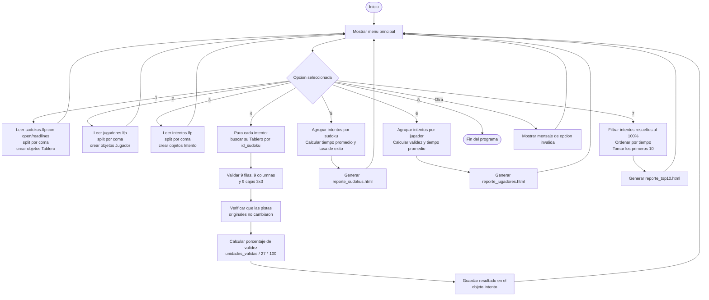
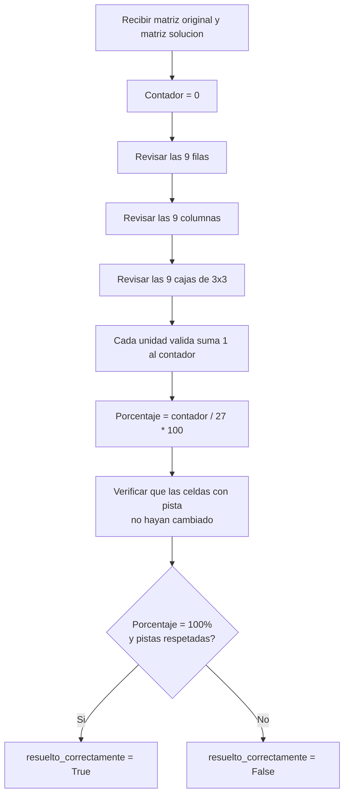

# Diagrama de Flujo

Representacion grafica del proceso general del sistema: lectura de archivos,
validacion matricial del tablero, calculo de estadisticas y generacion de
reportes.

## Detalle del subproceso de validacion (opcion 4)

