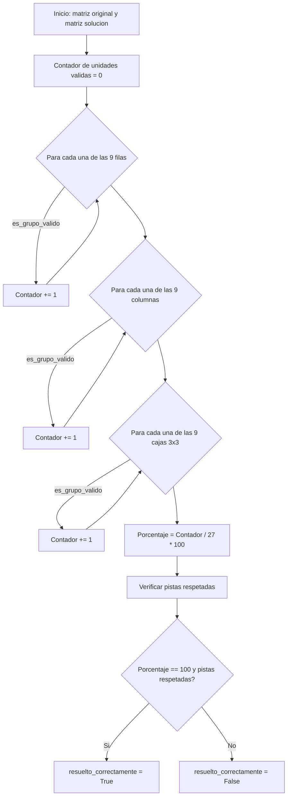

# Manual Tecnico

## 1. Objetivo del sistema

Implementar, mediante Programacion Orientada a Objetos, un motor de
validacion y calificacion de partidas de Sudoku para el torneo de Numerix
Academy, incluyendo la lectura de archivos delimitados por comas, la
validacion matricial de las reglas del juego y el calculo de metricas de
desempeno sobre los intentos registrados.

## 2. Arquitectura del proyecto

El sistema se organizo en capas con responsabilidades separadas:

| Capa | Carpeta | Responsabilidad |
|---|---|---|
| Modelo | `src/models/` | Representar tableros, jugadores e intentos como objetos |
| Servicios | `src/services/` | Cargar archivos, validar reglas, calcular metricas |
| Reportes | `src/reports/` | Generar los archivos HTML de salida |
| Interfaz | `src/ui/` | Mostrar el menu de consola |
| Orquestacion | `main.py` | Conectar todas las capas y manejar el flujo del programa |

Esta separacion sigue el principio de responsabilidad unica: cada modulo
tiene un solo motivo para cambiar (por ejemplo, si cambia el formato de los
reportes HTML, solo se modifica `src/reports/generador_html.py`, sin tocar la
logica de validacion).

## 3. Clases del modelo

### 3.1 `Tablero`

Representa un tablero de Sudoku del torneo.

- **Atributos:** `id_sudoku` (int), `dificultad` (str), `tablero_str` (str de
  81 caracteres), `matriz` (lista de 9 listas de 9 enteros).
- **Metodos:** `_construir_matriz()` convierte la cadena plana de 81
  caracteres en una matriz de 9x9, recorriendo la cadena en bloques de 9
  caracteres (una fila por bloque).

### 3.2 `Jugador`

Representa a un jugador inscrito en el torneo.

- **Atributos:** `carnet` (int), `nombre` (str), `apellido` (str), `nivel`
  (str).
- **Metodos:** `nombre_completo()` retorna `"{nombre} {apellido}"`.

### 3.3 `Intento`

Representa un intento de resolucion de un jugador sobre un tablero.

- **Atributos:** `carnet` (int), `id_sudoku` (int), `solucion_str` (str de 81
  caracteres), `tiempo_segundos` (int), `fecha` (str), `matriz` (la solucion
  propuesta como matriz 9x9), y tres atributos que se calculan durante la
  validacion: `porcentaje_validez`, `pistas_respetadas`,
  `resuelto_correctamente` (inicializados en `None`).
- **Metodos:** `_construir_matriz()`, con la misma logica que `Tablero`.

## 4. Logica de validacion matricial

La clase `ValidadorSudoku` (en `src/services/validador_sudoku.py`) es el
nucleo del sistema. Implementa la siguiente secuencia:

1. **`es_grupo_valido(grupo)`**: recibe una lista de 9 valores (una fila,
   columna o caja) y verifica que sea igual, como conjunto, a `{1, ..., 9}`.
   Esto garantiza simultaneamente que no haya digitos repetidos, que no haya
   ceros, y que no falte ningun digito.

2. **`obtener_columna(matriz, indice)`** y **`obtener_caja(matriz, caja_fila,
   caja_col)`**: extraen, respectivamente, una columna o una caja de 3x3 de
   la matriz, devolviendolas como una lista plana de 9 valores para poder
   reutilizar `es_grupo_valido` sobre cualquiera de las 27 unidades.

3. **`pistas_respetadas(matriz_original, matriz_solucion)`**: recorre las 81
   celdas y verifica que toda celda con valor distinto de 0 en el tablero
   original tenga el mismo valor en la solucion propuesta.

4. **`calificar_intento(matriz_original, matriz_solucion)`**: cuenta cuantas
   de las 27 unidades (9 filas + 9 columnas + 9 cajas) cumplen
   `es_grupo_valido`, calcula el porcentaje de validez
   `(unidades_validas / 27) * 100`, verifica las pistas, y determina si el
   intento fue resuelto correctamente (100% de validez y pistas respetadas).

5. **`validar_y_calificar(tablero, intento)`**: conecta el calculo anterior
   con los objetos reales del modelo, guardando el resultado directamente en
   los atributos del objeto `Intento`.

### Pseudocodigo de la validacion de una unidad (fila, columna o caja)

```
FUNCION es_grupo_valido(grupo):
    RETORNAR conjunto(grupo) == conjunto({1,2,3,4,5,6,7,8,9})
FIN FUNCION
```

### Diagrama de la logica de calificacion de un intento



## 5. Lectura de archivos

`CargadorArchivos` (en `src/services/cargador_archivos.py`) implementa tres
metodos (`cargar_sudokus`, `cargar_jugadores`, `cargar_intentos`), todos con
el mismo patron:

```
ABRIR archivo con open() y with
LEER todas las lineas con readlines()
PARA cada linea:
    quitar espacios/saltos de linea (strip)
    separar campos con split(',')
    construir el objeto correspondiente (Tablero, Jugador o Intento)
    guardarlo en la coleccion de retorno
RETORNAR la coleccion
```

Los sudokus y jugadores se almacenan en diccionarios (`{id: objeto}`) para
permitir busquedas en tiempo constante al relacionar los tres archivos
(por ejemplo, encontrar el tablero correspondiente a un intento). Los
intentos se almacenan en una lista, ya que no tienen una llave unica (un
jugador puede intentar el mismo tablero varias veces).

## 6. Calculo de metricas

`CalculadoraMetricas` (en `src/services/calculadora_metricas.py`) implementa
los tres reportes:

- **`resumen_por_sudoku`**: agrupa los intentos por `id_sudoku` y calcula
  cantidad de intentos, tiempo promedio y tasa de exito por tablero.
- **`rendimiento_por_jugador`**: agrupa los intentos por `carnet` y calcula
  cantidad de tableros distintos intentados, porcentaje de validez promedio,
  tiempo promedio y cantidad de tableros resueltos perfectamente.
- **`top_10_mejores_tiempos`**: filtra los intentos con
  `resuelto_correctamente == True`, los ordena de menor a mayor tiempo con
  `sorted(..., key=lambda i: i.tiempo_segundos)`, y toma los primeros 10.

## 7. Generacion de reportes HTML

`generador_html.py` (en `src/reports/`) construye el HTML de cada reporte
como texto (usando f-strings) y lo escribe con `open(ruta, "w")`. Una funcion
privada compartida (`_envolver_html`) centraliza el esqueleto HTML/CSS comun
a los tres reportes.

## 8. Manejo de excepciones

El punto de entrada (`main.py`) envuelve cada operacion de carga de archivo
en un bloque `try/except FileNotFoundError`, mostrando un mensaje claro al
usuario en vez de detener el programa con un traceback. Ademas, cada opcion
de generacion de reportes verifica que los datos necesarios hayan sido
cargados y validados previamente antes de intentar generarlos.

## 9. Requerimientos tecnicos cumplidos

- Python 3.x, sin librerias externas.
- Programacion Orientada a Objetos (clases `Tablero`, `Jugador`, `Intento`).
- Lectura de archivos con `open()`, `with`, `readlines()`.
- Separacion de datos con `split(',')`.
- Representacion de tableros como matrices (listas de listas).
- Estructuras de control (`if`, `for`, `while`) y colecciones nativas
  (listas, diccionarios, conjuntos).
- Generacion de reportes en HTML.
- Menu funcional en consola.
- Manejo de excepciones.
