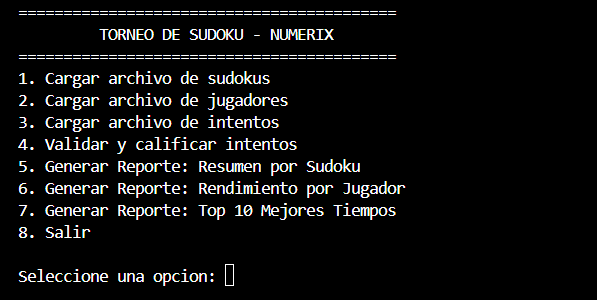
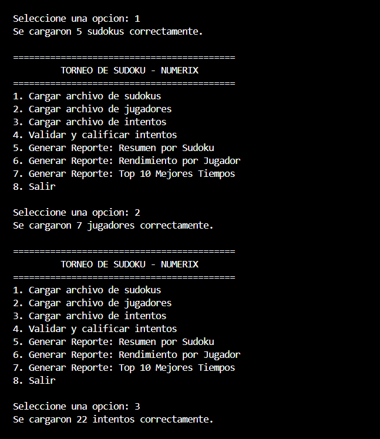
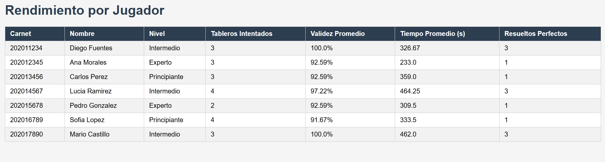
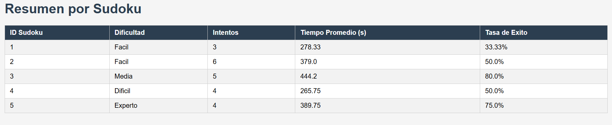
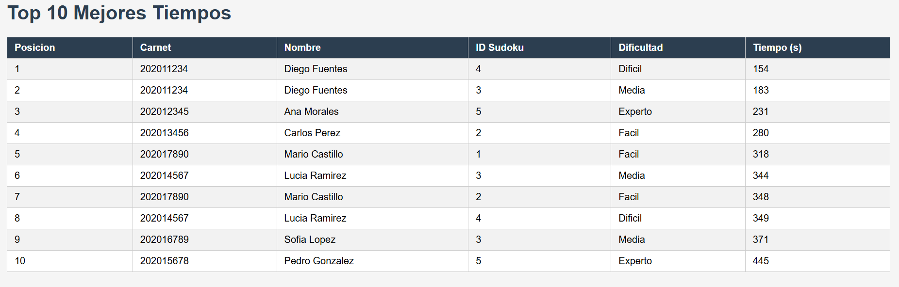

# Manual de Usuario

## 1. Requisitos previos

- Tener Python 3.x instalado (verificalo con `python --version` en tu
  terminal).
- Tener los tres archivos de datos (`sudokus.lfp`, `jugadores.lfp`,
  `intentos.lfp`) dentro de la carpeta `Practica1/data/`.

## 2. Como iniciar el programa

1. Abre una terminal (Git Bash, PowerShell, o la terminal de tu editor).
2. Ubicate dentro de la carpeta `Practica1`:

```bash
cd ruta/a/tu/proyecto/Practica1
```

3. Ejecuta:

```bash
python main.py
```

4. Deberia aparecer el menu principal:

```
==========================================
         TORNEO DE SUDOKU - NUMERIX
==========================================
1. Cargar archivo de sudokus
2. Cargar archivo de jugadores
3. Cargar archivo de intentos
4. Validar y calificar intentos
5. Generar Reporte: Resumen por Sudoku
6. Generar Reporte: Rendimiento por Jugador
7. Generar Reporte: Top 10 Mejores Tiempos
8. Salir

Seleccione una opcion:
```



## 3. Flujo de uso recomendado

### Paso 1: Cargar los tres archivos de datos

Escribe `1` y presiona Enter para cargar los sudokus. El programa confirma
cuantos se cargaron:

```
Se cargaron 5 sudokus correctamente.
```

Repite con `2` (jugadores) y `3` (intentos).



### Paso 2: Validar y calificar los intentos

Escribe `4` y presiona Enter. El programa revisa cada intento cargado contra
las reglas del Sudoku (filas, columnas, cajas de 3x3 y respeto de pistas) y
confirma:

```
Intentos validados y calificados correctamente.
```

### Paso 3: Generar los reportes

Escribe `5`, `6` o `7` (una opcion a la vez) para generar cada reporte. El
programa indica donde se guardo el archivo:

```
Reporte generado en: .../Practica1/reportes/reporte_sudokus.html
```

Abre ese archivo con cualquier navegador (doble clic, o arrastrarlo a
Chrome/Firefox/Edge) para ver el reporte.





### Paso 4: Salir

Escribe `8` para cerrar el programa de forma ordenada.

## 4. Mensajes de error esperados

- Si intentas generar un reporte antes de cargar los datos necesarios, el
  programa te lo indica:
  `"Debe cargar y validar los datos antes de generar el reporte."`
- Si algun archivo `.lfp` no se encuentra en `data/`, el programa muestra un
  mensaje de error especifico en vez de detenerse abruptamente.
- Si escribes una opcion que no existe en el menu (por ejemplo, `9`), el
  programa responde `"Opcion invalida, intente de nuevo."` y vuelve a
  mostrar el menu.

## 5. Descripcion de los reportes

| Reporte | Contenido |
|---|---|
| Resumen por Sudoku | Por cada tablero: id, dificultad, cantidad de intentos, tiempo promedio y tasa de exito |
| Rendimiento por Jugador | Por cada jugador: nombre, carnet, nivel, tableros intentados, validez promedio, tiempo promedio, resueltos perfectos |
| Top 10 Mejores Tiempos | Ranking de los 10 intentos mas rapidos entre los resueltos con 100% de validez |
