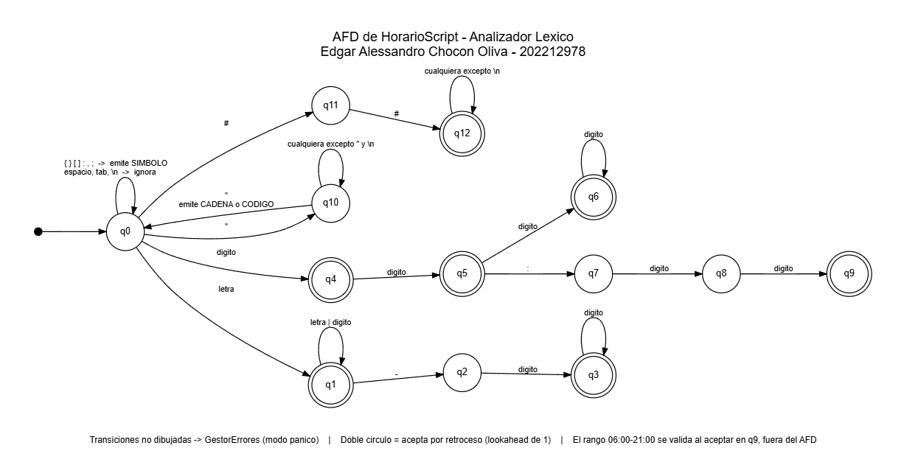

# Manual Tecnico - HorarioScript

**Autor:** Edgar Alessandro Chocon Oliva
**Carnet:** 202212978
**Curso:** Lenguajes Formales y de Programacion - Seccion B+
**Universidad de San Carlos de Guatemala - Facultad de Ingenieria**

---

## 1. Arquitectura del Sistema

_(Pendiente: M2)_

## 2. Diagrama de Clases

_(Pendiente: M2)_

---

## 3. Diseno del Automata Finito Determinista

### 3.1 Definicion formal

El analizador lexico se implementa como un AFD definido por la 5-tupla
**M = (Q, Sigma, delta, q0, F)**:

| Componente | Definicion |
|---|---|
| **Q** | 13 estados, `q0` a `q12` (seccion 3.3) |
| **Sigma** | Alfabeto de entrada (seccion 3.2) |
| **delta** | Funcion de transicion (seccion 3.4) |
| **q0** | Estado inicial |
| **F** | `{q1, q3, q4, q5, q6, q9, q12}` mas las aceptaciones inmediatas de `q0` y `q10` |

### 3.2 Alfabeto

| Categoria | Caracteres | Cantidad |
|---|---|---|
| Letras | `A-Z` `a-z` | 52 |
| Digitos | `0-9` | 10 |
| Estructurales | `{` `}` `[` `]` `:` `,` `;` | 7 |
| Especiales | `-` `"` `#` | 3 |
| Blancos | espacio, tabulador, `\r`, `\n` | 4 |
| **Total** | | **76** |

**Decision de diseno:** el alfabeto no se aplica de forma uniforme. El lenguaje
define tres contextos lexicos distintos:

| Contexto | Alfabeto permitido |
|---|---|
| Nivel superior (`q0`) | Los 76 caracteres anteriores |
| Dentro de una cadena (`q10`) | Cualquier caracter excepto `"` y `\n` |
| Dentro de un comentario (`q12`) | Cualquier caracter excepto `\n` |

Consecuencia verificable: el error `CARACTER_NO_RECONOCIDO` solo puede
originarse desde `q0`. Si se dispara desde cualquier otro estado, hay un defecto
en la implementacion.

### 3.3 Estados

| Estado | Significado |
|---|---|
| `q0` | Inicial |
| `q1` | Leyendo secuencia alfanumerica |
| `q2` | Leyo `-` tras alfanumerico, espera digito |
| `q3` | Leyendo digitos del codigo |
| `q4` | Lleva 1 digito |
| `q5` | Lleva 2 digitos |
| `q6` | Lleva 3 o mas digitos |
| `q7` | Leyo `DD:`, espera primer digito de minutos |
| `q8` | Leyo `DD:D`, espera segundo digito de minutos |
| `q9` | Leyo `DD:DD` (aceptacion de HORA) |
| `q10` | Dentro de cadena |
| `q11` | Leyo `#`, espera el segundo |
| `q12` | Dentro de comentario |

### 3.4 Tabla de transiciones

**Notacion:**

| Codigo | Significado |
|---|---|
| `qN` | Transicion al estado N, acumula el caracter |
| `R:TIPO` | Acepta TIPO retrocediendo (no consume el caracter) |
| `C:TIPO` | Acepta TIPO consumiendo el caracter |
| `E:XXX` | Error, entra en recuperacion de modo panico |
| `ign` | Ignora el caracter, actualiza linea/columna |

**Errores:** `CNR` = CARACTER_NO_RECONOCIDO · `CSC` = CADENA_SIN_CERRAR ·
`HFR` = HORA_FUERA_DE_RANGO · `CMF` = CODIGO_MAL_FORMADO

| Estado | Transiciones distinguidas | Resto |
|---|---|---|
| `q0` | `letra`→q1 · `digito`→q4 · `"`→q10 · `#`→q11 · `{}[]:,;`→`C:SIMBOLO` · blanco,`\n`→`ign` · EOF→`C:EOF` | `E:CNR` |
| `q1` | `letra\|digito`→q1 · `-`→q2 | `R:clasificar` |
| `q2` | `digito`→q3 | `E:CMF` |
| `q3` | `digito`→q3 · `letra`→`E:CMF` · `-`→`E:CMF` | `R:CODIGO` |
| `q4` | `digito`→q5 · `:`→`E:HFR` · `-`→`E:CMF` | `R:ENTERO` |
| `q5` | `digito`→q6 · `:`→q7 · `-`→`E:CMF` | `R:ENTERO` |
| `q6` | `digito`→q6 · `:`→`E:HFR` · `-`→`E:CMF` | `R:ENTERO` |
| `q7` | `digito`→q8 | `E:HFR` |
| `q8` | `digito`→q9 | `E:HFR` |
| `q9` | `digito`→`E:HFR` | `R:HORA` + validar rango |
| `q10` | `"`→`C:clasificar contenido` · `\n`→`E:CSC` · EOF→`E:CSC` | q10 |
| `q11` | `#`→q12 | `E:CNR('#')` |
| `q12` | `\n`→`R:COMENTARIO_LINEA` · EOF→`R:COMENTARIO_LINEA` | q12 |

**Sobre el formato de la tabla:** se presenta en forma dispersa. La forma densa
requeriria 13 estados por 11 clases de caracter = 143 celdas, de las cuales unas
110 repetirian la accion por defecto. Esta presentacion lista solo las
transiciones que distinguen, mas la accion por defecto explicita, y es la forma
estandar de documentar tablas de transicion sobre alfabetos grandes.

### 3.5 Diagrama del AFD

Codigo fuente del diagrama: [`afd.dot`](afd.dot)

Las transiciones de error no se dibujan: son aproximadamente 30 aristas que
apuntan todas al mismo manejador y volverian el diagrama ilegible. Su
comportamiento queda documentado en la columna "Resto" de la tabla 3.4.

---

## 4. Decisiones de Diseno

### 4.1 Maximal munch para palabras reservadas

El AFD no dedica estados a cada palabra reservada. El estado `q1` reconoce la
*forma* (secuencia alfanumerica) y un diccionario resuelve la *identidad* al
aceptar.

**Justificacion:** ocho palabras reservadas empiezan con `c` (`con`, `curso`,
`clase`, `codigo`, `creditos`, `categoria`, `capacidad`, `catedratico`). Un
estado por palabra exigiria un arbol de prefijos compartidos de unos 60 estados
mas un mecanismo de retroceso para las entradas que fallan a mitad de camino. La
separacion forma/identidad reduce eso a 1 estado y 6 diccionarios.

### 4.2 Validacion del rango horario fuera del automata

El AFD valida la **forma** `DD:DD`. El rango institucional 06:00-21:00 se valida
en la accion de aceptacion de `q9`, sobre el lexema ya reconocido.

**Justificacion:** el conjunto de horas validas es finito (960 combinaciones) y
por lo tanto es un lenguaje regular expresable como AFD. Pero hacerlo exigiria
ramificar `q5` en un camino por cada hora valida, y cada uno en 60 caminos de
minutos: cientos de estados, diagrama ilegible, y un rediseno completo del
automata ante cualquier cambio de horario institucional.

Consecuencia observable: `100:00` falla **dentro** del automata (transicion
invalida en `q6`), mientras que `07:60` lo recorre completo hasta `q9` y falla
**despues**, en la validacion de rango. Ambos reportan `HORA_FUERA_DE_RANGO`,
por dos mecanismos distintos.

### 4.3 Subclasificacion de literales entrecomillados

La seccion 4.5 del enunciado presenta los ejemplos de `CODIGO` entre comillas
(`"LFP-0796"`, `"A-101"`), pero tambien define `CADENA` como todo texto entre
comillas dobles. El archivo de ejemplo de la seccion 4.6 usa comillas en todos
los codigos.

**Resolucion adoptada:** el AFD recorre el literal por el camino de cadena
(`q10`). Al cerrar la comilla, inspecciona el contenido: si cumple el patron
`L (L|D)* - D+`, el tipo emitido es `CODIGO`; en caso contrario, `CADENA`. El
lexema conserva las comillas en ambos casos.

Ejemplos: `"A-101"` y `"T-3"` producen `CODIGO`; `"Otto Rodriguez"` y `"N"`
producen `CADENA`.

### 4.4 Patron de codigo

Se adopta `L (L|D)* - D+`: un codigo debe iniciar con letra. Una secuencia que
inicie con digito y contenga guion se reporta como `CODIGO_MAL_FORMADO`.

### 4.5 Palabras reservadas de atributo

El enunciado no clasifica `codigo`, `creditos`, `categoria`, `capacidad`,
`edificio`, `dia`, `inicio`, `fin` ni `seccion`, pero las usa en el archivo de
ejemplo. Se declaran como una cuarta categoria, `PALABRA_RESERVADA_ATRIBUTO`.
Sin esta decision, el lenguaje careceria de un tipo de token valido para ellas,
ya que HorarioScript no admite identificadores libres.

### 4.6 Contexto minimo para la deteccion de valores no reconocidos

La seccion 4.8 del enunciado exige el error `DIA_NO_RECONOCIDO`. Determinar que
`LUNEZ` pretendia ser un dia requiere saber que aparecio tras el atributo `dia`,
lo cual es informacion de contexto que un AFD puro no conserva.

**Resolucion adoptada:** el analizador mantiene una unica variable con el ultimo
atributo emitido. Ante una palabra alfanumerica ausente de todos los
diccionarios, emite `DIA_NO_RECONOCIDO` si el ultimo atributo fue `dia`,
`CATEGORIA_NO_RECONOCIDA` si fue `categoria`, y `PALABRA_NO_RECONOCIDA` en
cualquier otro caso.

Esta tecnica tiene precedente en compiladores de produccion: el *lexer hack* del
lenguaje C, donde el analizador lexico consulta la tabla de simbolos para
distinguir un nombre de tipo de un identificador.

---

## 5. Algoritmo de Tokenizacion

_(Pendiente: M2)_

## 6. Deteccion de Choques de Horario

_(Pendiente: M4)_