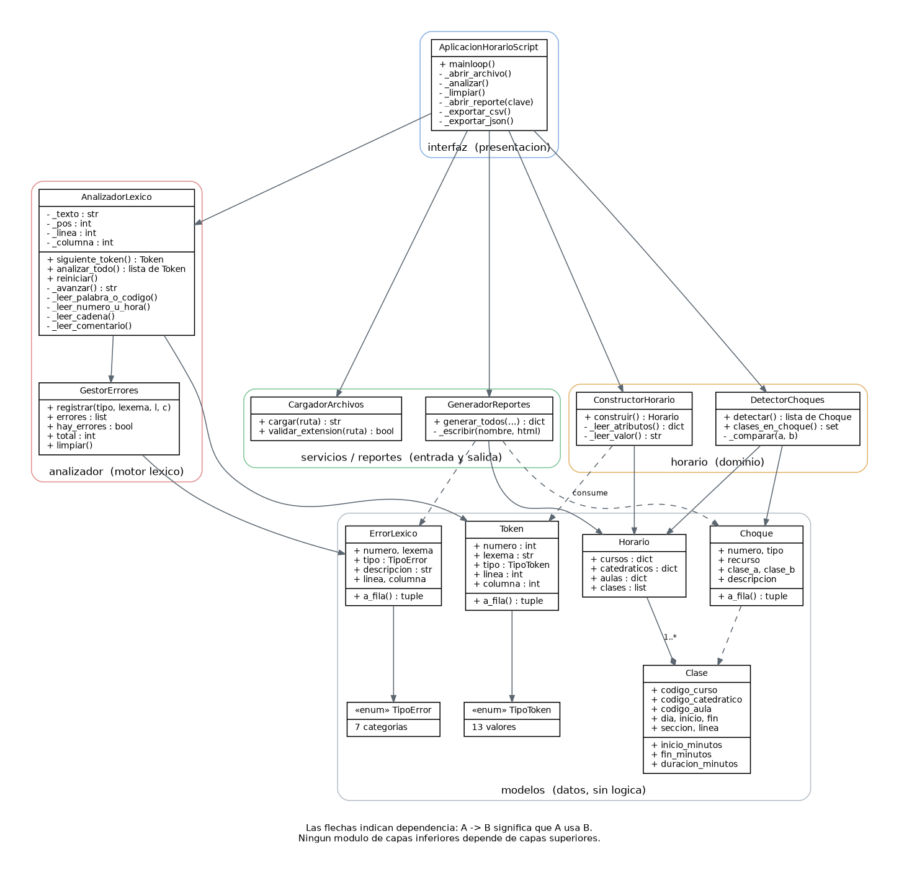

# Manual Tecnico - HorarioScript

**Autor:** Edgar Alessandro Chocon Oliva
**Carnet:** 202212978
**Curso:** Lenguajes Formales y de Programacion - Seccion B+
**Universidad de San Carlos de Guatemala - Facultad de Ingenieria**
**Segundo Semestre 2026**

---

## 1. Arquitectura del Sistema

### 1.1 Organizacion en capas

El sistema se organiza en cinco capas. Cada una depende unicamente de las que
estan por debajo, nunca al reves.

```
  interfaz        AplicacionHorarioScript (Tkinter)
      |
      v
  servicios       CargadorArchivos            reportes   GeneradorReportes
      |                                           |
      v                                           v
  horario         ConstructorHorario, DetectorChoques
      |
      v
  analizador      AnalizadorLexico, GestorErrores, alfabeto, palabras_reservadas
      |
      v
  modelos         Token, TipoToken, ErrorLexico, TipoError,
                  Curso, Catedratico, Aula, Clase, Choque, Horario
```

| Capa | Paquete | Responsabilidad |
|---|---|---|
| Presentacion | `src/interfaz/` | Recibir acciones del usuario y mostrar resultados. No contiene logica de analisis |
| Entrada y salida | `src/servicios/`, `src/reportes/` | Leer archivos `.hor` y producir documentos HTML |
| Dominio | `src/horario/` | Reconstruir las entidades del horario y detectar conflictos |
| Motor lexico | `src/analizador/` | Tokenizar el texto y acumular errores |
| Datos | `src/modelos/` | Estructuras sin comportamiento de negocio |

### 1.2 Justificacion de la separacion

**El motor lexico no importa nada de la interfaz ni de los reportes.** Esta es
la decision arquitectonica central: el componente que concentra el mayor peso
academico puede ejecutarse y probarse por completo desde consola, sin abrir la
ventana grafica. La suite `pruebas/pruebas_lexer.py` lo verifica sin instanciar
un solo widget.

**Los modelos no tienen logica de negocio.** Un `Token` no sabe generar HTML ni
dibujarse. Esto evita el acoplamiento circular en el que una estructura de
datos conoce a quien la consume.

**La interfaz es delgada.** `AplicacionHorarioScript` se limita a orquestar:
pide el archivo al cargador, se lo pasa al analizador, entrega los tokens al
constructor, el horario al detector, y todo al generador de reportes. Si
manana la interfaz cambiara a web, ninguna de las otras capas se tocaria.

**El analizador expone dos APIs.** `siguiente_token()` devuelve un token a la
vez, que es como lo consumira el analizador sintactico del Proyecto 2.
`analizar_todo()` se construye sobre el anterior y devuelve la lista completa,
que es lo que necesita la tabla de la interfaz. El orden de dependencia importa:
si la lista fuera la primitiva, el analizador sintactico tendria que reescribir
el motor.

### 1.3 Flujo de datos de un analisis

```
archivo .hor
     |
     v
CargadorArchivos.cargar()              valida existencia, tipo, extension y codificacion
     |
     v  texto : str
AnalizadorLexico.analizar_todo()       recorre caracter a caracter segun el AFD
     |                                 registra errores en GestorErrores y continua
     +--> lista de Token
     +--> lista de ErrorLexico
     |
     v
ConstructorHorario.construir()         extrae entidades de la secuencia de tokens
     |
     v  Horario
DetectorChoques.detectar()             compara todos los pares de clases
     |
     v  lista de Choque
GeneradorReportes.generar_todos()      escribe los cuatro documentos HTML
     |
     v
salidas/<archivo>/*.html
```

---

## 2. Diagrama de Clases



Codigo fuente del diagrama: [`clases.dot`](clases.dot)

### 2.1 Clases principales

| Clase | Paquete | Responsabilidad |
|---|---|---|
| `AplicacionHorarioScript` | `interfaz` | Ventana principal, orquesta el flujo completo |
| `CargadorArchivos` | `servicios` | Lee y valida archivos `.hor` |
| `AnalizadorLexico` | `analizador` | AFD manual; implementa `siguiente_token()` |
| `GestorErrores` | `analizador` | Acumula errores y permite continuar el analisis |
| `ConstructorHorario` | `horario` | Reconstruye entidades desde la lista de tokens |
| `DetectorChoques` | `horario` | Detecta conflictos de catedratico y de aula |
| `GeneradorReportes` | `reportes` | Fachada que genera y guarda los cuatro HTML |
| `Token` | `modelos` | Unidad lexica con lexema, tipo, linea y columna |
| `ErrorLexico` | `modelos` | Error con categoria, descripcion y posicion |
| `Horario` | `modelos` | Contenedor de cursos, catedraticos, aulas y clases |
| `Clase` | `modelos` | Bloque de clase con dia, horas y recursos |
| `Choque` | `modelos` | Conflicto detectado entre dos bloques |

### 2.2 Enumeraciones

| Enumeracion | Valores | Proposito |
|---|---|---|
| `TipoToken` | 13 | Clasificacion de cada lexema reconocido |
| `TipoError` | 7 | Categorias de error lexico |

Ambas heredan de `str`, de modo que cada miembro se comporta como una cadena y
puede mostrarse directamente en la interfaz y en los reportes sin conversion.
Usar enumeraciones en lugar de cadenas sueltas evita el error mas frecuente en
este tipo de proyecto: escribir `"CODIGO"` en un archivo y `"CODIGO "` con
espacio en otro. Con `TipoToken.CODIGO`, un error de escritura falla al
importar, no tres horas despues en un reporte vacio.

---

## 3. Diseno del Automata Finito Determinista

### 3.1 Definicion formal

El analizador lexico se implementa como un AFD definido por la 5-tupla
**M = (Q, Sigma, delta, q0, F)**:

| Componente | Definicion |
|---|---|
| **Q** | 13 estados, `q0` a `q12` (seccion 3.3) |
| **Sigma** | Alfabeto de entrada (seccion 3.2) |
| **delta** | Funcion de transicion (seccion 3.4) |
| **q0** | Estado inicial |
| **F** | `{q1, q3, q4, q5, q6, q9, q12}` mas las aceptaciones inmediatas de `q0` y `q10` |

### 3.2 Alfabeto

| Categoria | Caracteres | Cantidad |
|---|---|---|
| Letras | `A-Z` `a-z` | 52 |
| Digitos | `0-9` | 10 |
| Estructurales | `{` `}` `[` `]` `:` `,` `;` | 7 |
| Especiales | `-` `"` `#` | 3 |
| Blancos | espacio, tabulador, `\r`, `\n` | 4 |
| **Total** | | **76** |

**Decision de diseno:** el alfabeto no se aplica de forma uniforme. El lenguaje
define tres contextos lexicos distintos:

| Contexto | Alfabeto permitido |
|---|---|
| Nivel superior (`q0`) | Los 76 caracteres anteriores |
| Dentro de una cadena (`q10`) | Cualquier caracter excepto `"` y `\n` |
| Dentro de un comentario (`q12`) | Cualquier caracter excepto `\n` |

Consecuencia verificable: el error `CARACTER_NO_RECONOCIDO` solo puede
originarse desde `q0`. Si se dispara desde cualquier otro estado, hay un
defecto en la implementacion. El caso 9 del documento de casos de prueba
comprueba este comportamiento.

### 3.3 Estados

| Estado | Significado |
|---|---|
| `q0` | Inicial |
| `q1` | Leyendo secuencia alfanumerica |
| `q2` | Leyo `-` tras alfanumerico, espera digito |
| `q3` | Leyendo digitos del codigo |
| `q4` | Lleva 1 digito |
| `q5` | Lleva 2 digitos |
| `q6` | Lleva 3 o mas digitos |
| `q7` | Leyo `DD:`, espera primer digito de minutos |
| `q8` | Leyo `DD:D`, espera segundo digito de minutos |
| `q9` | Leyo `DD:DD` (aceptacion de HORA) |
| `q10` | Dentro de cadena |
| `q11` | Leyo `#`, espera el segundo |
| `q12` | Dentro de comentario |

### 3.4 Tabla de transiciones

**Notacion:**

| Codigo | Significado |
|---|---|
| `qN` | Transicion al estado N, acumula el caracter |
| `R:TIPO` | Acepta TIPO retrocediendo (no consume el caracter) |
| `C:TIPO` | Acepta TIPO consumiendo el caracter |
| `E:XXX` | Error, entra en recuperacion de modo panico |
| `ign` | Ignora el caracter, actualiza linea/columna |

**Errores:** `CNR` = CARACTER_NO_RECONOCIDO · `CSC` = CADENA_SIN_CERRAR ·
`HFR` = HORA_FUERA_DE_RANGO · `CMF` = CODIGO_MAL_FORMADO

| Estado | Transiciones distinguidas | Resto |
|---|---|---|
| `q0` | `letra`→q1 · `digito`→q4 · `"`→q10 · `#`→q11 · `{}[]:,;`→`C:SIMBOLO` · blanco,`\n`→`ign` · EOF→`C:EOF` | `E:CNR` |
| `q1` | `letra\|digito`→q1 · `-`→q2 | `R:clasificar` |
| `q2` | `digito`→q3 | `E:CMF` |
| `q3` | `digito`→q3 · `letra`→`E:CMF` · `-`→`E:CMF` | `R:CODIGO` |
| `q4` | `digito`→q5 · `:`→`E:HFR` · `-`→`E:CMF` | `R:ENTERO` |
| `q5` | `digito`→q6 · `:`→q7 · `-`→`E:CMF` | `R:ENTERO` |
| `q6` | `digito`→q6 · `:`→`E:HFR` · `-`→`E:CMF` | `R:ENTERO` |
| `q7` | `digito`→q8 | `E:HFR` |
| `q8` | `digito`→q9 | `E:HFR` |
| `q9` | `digito`→`E:HFR` | `R:HORA` + validar rango |
| `q10` | `"`→`C:clasificar contenido` · `\n`→`E:CSC` · EOF→`E:CSC` | q10 |
| `q11` | `#`→q12 | `E:CNR('#')` |
| `q12` | `\n`→`R:COMENTARIO_LINEA` · EOF→`R:COMENTARIO_LINEA` | q12 |

**Sobre el formato de la tabla:** se presenta en forma dispersa. La forma densa
requeriria 13 estados por 11 clases de caracter = 143 celdas, de las cuales
unas 110 repetirian la accion por defecto. Esta presentacion lista solo las
transiciones que distinguen, mas la accion por defecto explicita, y es la forma
estandar de documentar tablas de transicion sobre alfabetos grandes.

### 3.5 Diagrama del AFD


Codigo fuente del diagrama: [`afd.dot`](afd.dot)

Las transiciones de error no se dibujan: son aproximadamente 30 aristas que
apuntan todas al mismo manejador y volverian el diagrama ilegible. Su
comportamiento queda documentado en la columna "Resto" de la tabla 3.4.

---

## 4. Decisiones de Diseno

### 4.1 Maximal munch para palabras reservadas

El AFD no dedica estados a cada palabra reservada. El estado `q1` reconoce la
*forma* (secuencia alfanumerica) y un diccionario resuelve la *identidad* al
aceptar.

**Justificacion:** ocho palabras reservadas empiezan con `c` (`con`, `curso`,
`clase`, `codigo`, `creditos`, `categoria`, `capacidad`, `catedratico`). Un
estado por palabra exigiria un arbol de prefijos compartidos de unos 60 estados
mas un mecanismo de retroceso para las entradas que fallan a mitad de camino.
La separacion forma/identidad reduce eso a 1 estado y 6 diccionarios.

### 4.2 Validacion del rango horario fuera del automata

El AFD valida la **forma** `DD:MM`. El rango institucional 06:00-21:00 se valida
en la accion de aceptacion de `q9`, sobre el lexema ya reconocido.

**Justificacion:** el conjunto de horas validas es finito (960 combinaciones) y
por lo tanto es un lenguaje regular expresable como AFD. Pero hacerlo exigiria
ramificar `q5` en un camino por cada hora valida, y cada uno en 60 caminos de
minutos: cientos de estados, diagrama ilegible, y un rediseno completo del
automata ante cualquier cambio de horario institucional.

Consecuencia observable: `100:00` falla **dentro** del automata (transicion
invalida en `q6`), mientras que `07:60` lo recorre completo hasta `q9` y falla
**despues**, en la validacion de rango. Ambos reportan `HORA_FUERA_DE_RANGO`,
por dos mecanismos distintos.

### 4.3 Subclasificacion de literales entrecomillados

La seccion 4.5 del enunciado presenta los ejemplos de `CODIGO` entre comillas
(`"LFP-0796"`, `"A-101"`), pero tambien define `CADENA` como todo texto entre
comillas dobles. El archivo de ejemplo de la seccion 4.6 usa comillas en todos
los codigos.

**Resolucion adoptada:** el AFD recorre el literal por el camino de cadena
(`q10`). Al cerrar la comilla, inspecciona el contenido: si cumple el patron
`L (L|D)* - D+`, el tipo emitido es `CODIGO`; en caso contrario, `CADENA`. El
lexema conserva las comillas en ambos casos.

Ejemplos: `"A-101"` y `"T-3"` producen `CODIGO`; `"Otto Rodriguez"` y `"N"`
producen `CADENA`.

### 4.4 Patron de codigo

Se adopta `L (L|D)* - D+`: un codigo debe iniciar con letra. Una secuencia que
inicie con digito y contenga guion se reporta como `CODIGO_MAL_FORMADO`.

### 4.5 Palabras reservadas de atributo

El enunciado no clasifica `codigo`, `creditos`, `categoria`, `capacidad`,
`edificio`, `dia`, `inicio`, `fin` ni `seccion`, pero las usa en el archivo de
ejemplo. Se declaran como una cuarta categoria,
`PALABRA_RESERVADA_ATRIBUTO`. Sin esta decision, el lenguaje careceria de un
tipo de token valido para ellas, ya que HorarioScript no admite identificadores
libres.

### 4.6 Contexto minimo para la deteccion de valores no reconocidos

La seccion 4.8 del enunciado exige el error `DIA_NO_RECONOCIDO`. Determinar que
`LUNEZ` pretendia ser un dia requiere saber que aparecio tras el atributo `dia`,
lo cual es informacion de contexto que un AFD puro no conserva.

**Resolucion adoptada:** el analizador mantiene una unica variable con el ultimo
atributo emitido. Ante una palabra alfanumerica ausente de todos los
diccionarios, emite `DIA_NO_RECONOCIDO` si el ultimo atributo fue `dia`,
`CATEGORIA_NO_RECONOCIDA` si fue `categoria`, y `PALABRA_NO_RECONOCIDA` en
cualquier otro caso.

Esta tecnica tiene precedente en compiladores de produccion: el *lexer hack* del
lenguaje C, donde el analizador lexico consulta la tabla de simbolos para
distinguir un nombre de tipo de un identificador.

### 4.7 Ancho del tabulador

El criterio 2.1 del enunciado menciona los tabuladores de forma explicita. Se
adopta la regla **un caracter es una columna**, de modo que un tabulador avanza
el contador en 1. La decision se concentra en la constante `ANCHO_TABULACION`
de `analizador_lexico.py`, de modo que adoptar paradas de tabulacion de 4 u 8
columnas requiere cambiar un solo numero.

### 4.8 Umbrales de los reportes

| Parametro | Valor adoptado | Origen |
|---|---|---|
| Niveles de carga | BAJA ≤4 h, NORMAL ≤10 h, ALTA ≤15 h, SATURADA >15 h | Los sugeridos por el enunciado |
| Bloques disponibles por aula | 6 dias x 15 horas = 90 h semanales | Jornada institucional 06:00-21:00 |
| Ocupacion critica | Mayor al 80 por ciento | El indicado por el enunciado |

El enunciado deja los umbrales de carga abiertos a ajuste con justificacion. Se
conservan los sugeridos por no existir informacion adicional que respalde otros
valores.

---

## 5. Algoritmo de Tokenizacion

### 5.1 Las tres primitivas de lectura

Todo el recorrido se apoya en tres metodos, y solo uno de ellos mueve el cursor.

| Primitiva | Mueve el cursor | Proposito |
|---|---|---|
| `_caracter_actual()` | No | Devuelve el caracter bajo el cursor |
| `_mirar(n)` | No | Devuelve un caracter adelantado, sin consumirlo |
| `_avanzar()` | **Si** | Consume el caracter y actualiza linea y columna |

**`_avanzar()` es el unico metodo de la clase que modifica `_pos`, `_linea` o
`_columna`.** Esta restriccion es deliberada: si dos metodos pudieran mover el
cursor, bastaria que uno olvidara actualizar la columna para que todas las
posiciones a partir de cierto punto quedaran corridas, y el defecto seria muy
dificil de localizar. Es una aplicacion del principio de separacion entre
comandos y consultas.

Las tres devuelven la **cadena vacia** al llegar al fin de archivo. Ese valor
centinela hace que las comparaciones se resuelvan solas: `es_letra("")` es
falso, `"" == '"'` es falso. Devolver `None` en su lugar obligaria a comprobar
la nulidad antes de cada comparacion del automata.

### 5.2 Estructura de `siguiente_token()`

```
repetir indefinidamente:
    1. consumir blancos y saltos de linea            (estado q0, delimitadores silenciosos)
    2. si no queda texto  ->  devolver token FIN_ARCHIVO
    3. guardar linea y columna de inicio del lexema
    4. despachar segun el caracter actual:
         letra    -> _leer_palabra_o_codigo()        (q1, q2, q3)
         digito   -> _leer_numero_u_hora()           (q4 a q9)
         comilla  -> _leer_cadena()                  (q10)
         numeral  -> _leer_comentario()              (q11, q12)
         simbolo  -> emitir SIMBOLO aqui mismo
         otro     -> registrar CARACTER_NO_RECONOCIDO y consumir
    5. si el lector devolvio un token  ->  devolverlo
       si devolvio None                ->  repetir el ciclo
```

El paso 4 es, linea por linea, la fila `q0` de la tabla de transiciones. El
despacho tiene seis casos porque la fila `q0` tiene seis columnas distinguidas.

La posicion se captura en el paso 3, **despues** de saltar blancos y **antes**
de consumir el primer caracter del lexema. Capturarla antes de saltar blancos
haria que `"  HORARIO"` se reportara en la columna 1 en lugar de la 3.

### 5.3 Recuperacion en modo panico

Los cuatro lectores devuelven `Token` si reconocieron uno, o `None` si
registraron un error. Cuando `siguiente_token()` recibe `None`, **no devuelve
nada**: el bucle vuelve a empezar y busca el siguiente token valido.

La ausencia de una instruccion `return` en ese punto es lo que implementa el
requisito del enunciado de que el analisis no se detenga ante el primer error.

Dos reglas adicionales sostienen la recuperacion:

**Toda rama debe consumir al menos un caracter.** Si la rama de error registrara
el problema sin avanzar el cursor, el bucle encontraria el mismo caracter
indefinidamente. El sintoma no seria una excepcion sino un bloqueo del programa.

**Un error de entrada produce un error de salida.** Ante `7:00`, el analizador
no reporta un error y luego emite `SIMBOLO(:)` y `ENTERO(00)` como tokens
validos: consume toda la secuencia de digitos y dos puntos, y la reporta como un
unico `HORA_FUERA_DE_RANGO`. Los metodos `_consumir_resto_invalido()` y
`_consumir_resto_hora_invalida()` cumplen esa funcion.

### 5.4 Retroceso con un caracter de anticipacion

Cuando `q5` encuentra una coma, acepta el `ENTERO` pero **no la consume**: la
deja para que `q0` la lea como `SIMBOLO` en la siguiente llamada.

En la implementacion no existe ninguna operacion de "devolver" el caracter:
retroceder consiste, simplemente, en no haber llamado a `_avanzar()`. Cuando la
condicion de un bucle `while` falla, el caracter sigue disponible.

### 5.5 Representacion de los estados en el codigo

Los estados no se representan con una variable `estado` y un `if/elif` gigante,
sino con la estructura del propio codigo, y cada bloque se anota con el estado
que implementa mediante un comentario `# Estado qN`.

Un caso ilustra la equivalencia. Los estados `q4`, `q5` y `q6` se diferencian
unicamente en cuantos digitos se llevan consumidos, y solo desde `q5` es legal
un `:`. El codigo los representa con un contador:

```python
lexema = self._avanzar()
digitos = 1
while es_digito(self._caracter_actual()):
    lexema += self._avanzar()
    digitos += 1
...
if siguiente == DOS_PUNTOS:
    if digitos != DIGITOS_DE_HORA:
        # error: solo q5 admite los dos puntos
```

En el diagrama son tres estados porque un automata no dispone de variables; en
el codigo son un contador porque Python si. La correspondencia con la tabla se
mantiene exacta y se evita triplicar el mismo bloque.

---

## 6. Deteccion de Choques de Horario

### 6.1 Reconstruccion previa de las entidades

El analizador lexico produce una **lista plana de tokens**. Para detectar
choques hacen falta objetos con dia, horas y recursos, asi que
`ConstructorHorario` traduce la secuencia de tokens en entidades.

**No es un analizador sintactico.** No valida la gramatica del archivo, no
construye un arbol y no reporta errores de estructura, porque eso corresponde al
Proyecto 2. Recorre la lista linealmente y, cuando encuentra `curso`,
`catedratico`, `aula` o `clase`, recoge el valor principal y los pares
`atributo: valor` encerrados entre corchetes. Lo que este mal formado
simplemente no aporta datos, y el recorrido continua.

Una asimetria del lenguaje que el constructor respeta: en `CURSOS` y
`CATEDRATICOS` el identificador viene en el atributo `codigo:`, mientras que en
`AULAS` el valor principal **es** el codigo (`aula: "A-101"`). Asi aparece en el
archivo de ejemplo del enunciado.

### 6.2 Normalizacion del tiempo

Cada hora `HH:MM` se convierte a **minutos desde medianoche**:

```
"07:00"  ->  7 * 60 + 0   =  420
"08:40"  ->  8 * 60 + 40  =  520
"21:00"  -> 21 * 60 + 0   = 1260
```

Un bloque horario queda reducido a un par de enteros, y comparar bloques se
vuelve aritmetica entera. La conversion vive en `hora_a_minutos()`, y `Clase`
la expone como las propiedades `inicio_minutos`, `fin_minutos` y
`duracion_minutos`.

### 6.3 Condicion de choque

Existe un choque cuando se cumplen **las tres condiciones a la vez**:

1. Mismo **dia**
2. **Traslape** de los bloques horarios
3. Mismo **catedratico** o misma **aula**

### 6.4 El predicado de traslape

```python
def hay_traslape(inicio_a, fin_a, inicio_b, fin_b):
    return inicio_a < fin_b and inicio_b < fin_a
```

**Derivacion.** Enumerar los casos en que dos intervalos si se traslapan da
cuatro situaciones distintas y es propenso a error. Enumerar cuando **no** se
traslapan da solo dos: que A termine antes de que empiece B, o que B termine
antes de que empiece A.

```
no hay traslape  <=>  fin_a <= inicio_b   o   fin_b <= inicio_a
```

Negando esa disyuncion por las leyes de De Morgan:

```
hay traslape     <=>  fin_a > inicio_b   y   fin_b > inicio_a
```

que reescrito es la expresion implementada.

**Los intervalos son semiabiertos `[inicio, fin)`.** El inicio pertenece al
bloque y el fin no, de modo que una clase que termina a las 08:40 no choca con
otra que empieza a las 08:40: el aula se libera en el instante en que la clase
termina. Esa decision es la que determina que las comparaciones usen `<` y no
`<=`, y el caso 8 del documento de casos de prueba la verifica.

### 6.5 Algoritmo de comparacion

`DetectorChoques.detectar()` compara todos los pares de clases, sin repetir:

```python
for indice_a in range(len(clases)):
    for indice_b in range(indice_a + 1, len(clases)):
        self._comparar(clases[indice_a], clases[indice_b])
```

El costo es cuadratico respecto al numero de clases. Para un horario academico,
con decenas de bloques, el costo es despreciable y el algoritmo se mantiene
trivial de verificar a mano. Un barrido ordenado por hora bajaria el orden a
n log n, pero introduciria complejidad sin beneficio medible a esta escala.

### 6.6 Un par de clases puede producir dos choques

`_comparar()` evalua por separado el catedratico y el aula. Si dos clases
comparten ambos recursos, se registran **dos** choques distintos.

No es una duplicacion: son dos problemas con soluciones diferentes. Uno se
resuelve reasignando al catedratico y el otro cambiando de aula. Reportarlos por
separado le indica al usuario que tiene dos correcciones pendientes, no una.

### 6.7 Resaltado en el Reporte 1

`clases_en_choque()` devuelve el conjunto de identificadores de objeto de todas
las clases involucradas en algun conflicto. El generador del Reporte 1 consulta
ese conjunto al pintar cada celda: las clases presentes reciben fondo rojo y la
marca `CHOQUE DE HORARIO`; el resto aparece en verde como confirmadas.
