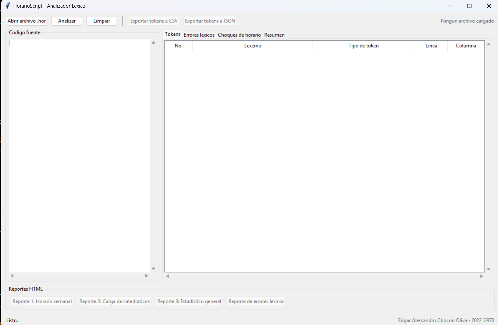
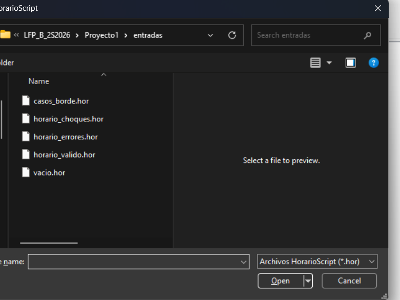
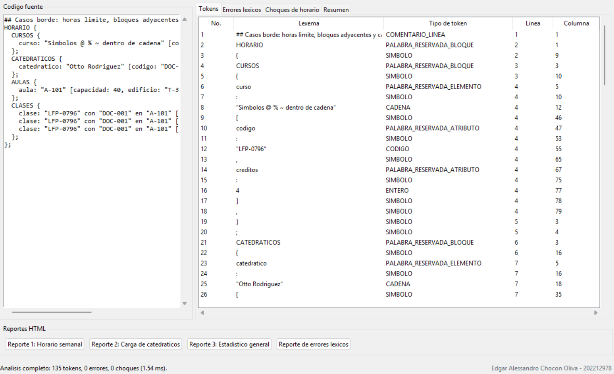
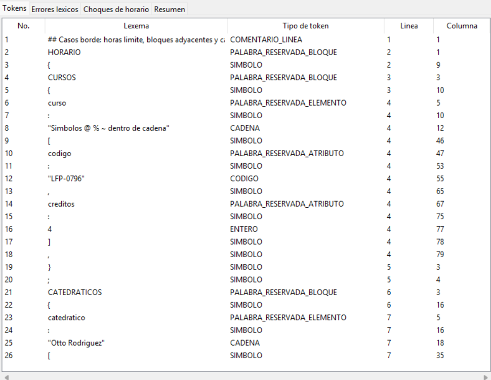
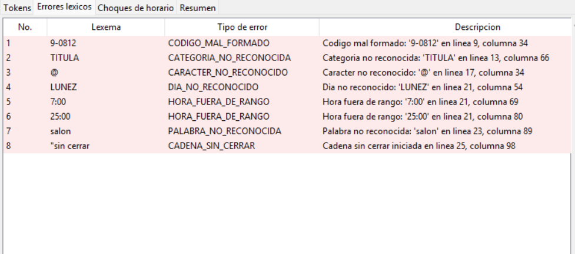
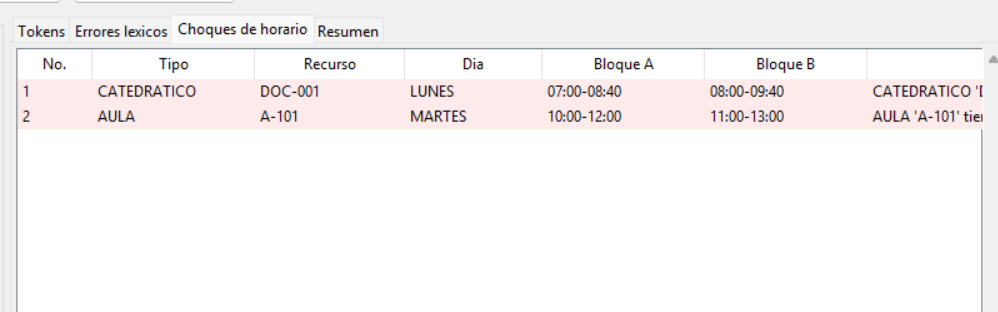
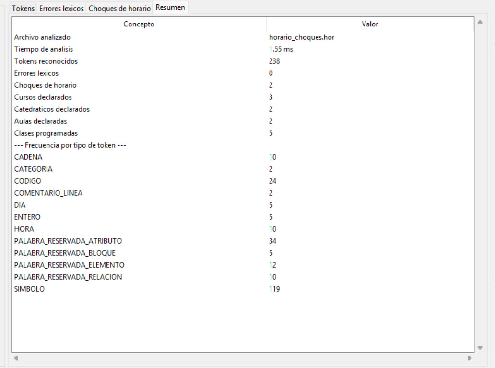
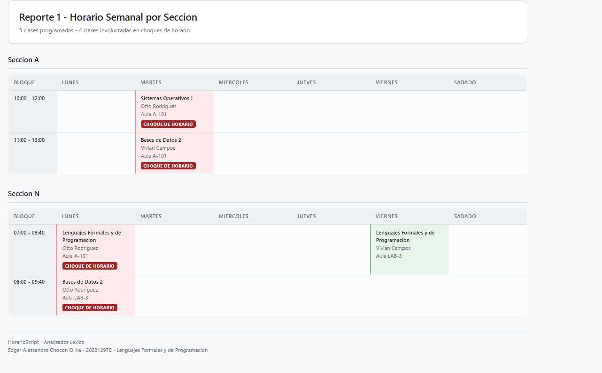
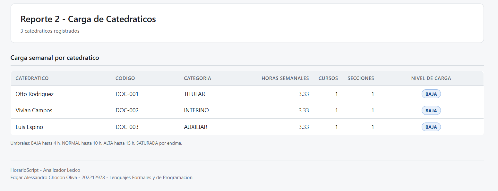
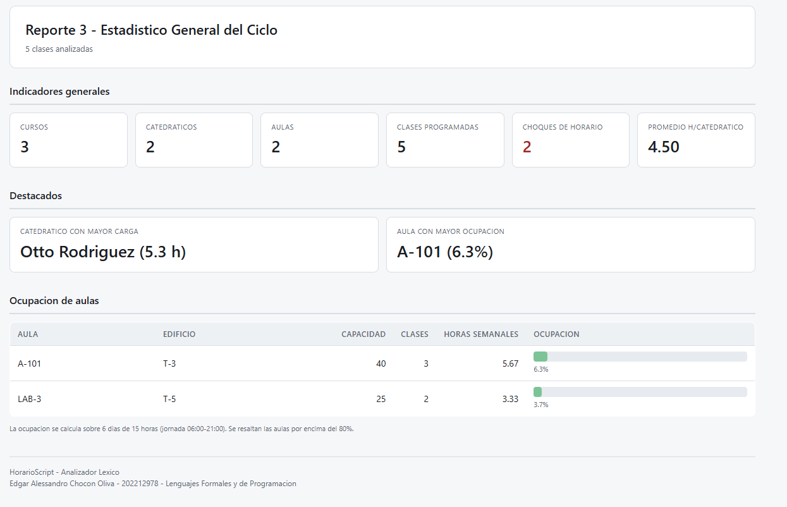

# Manual de Usuario - HorarioScript

**Autor:** Edgar Alessandro Chocon Oliva
**Carnet:** 202212978
**Curso:** Lenguajes Formales y de Programacion - Seccion B+
**Universidad de San Carlos de Guatemala - Facultad de Ingenieria**

---

## Indice

1. [Que hace la aplicacion](#1-que-hace-la-aplicacion)
2. [Requisitos y puesta en marcha](#2-requisitos-y-puesta-en-marcha)
3. [La ventana principal](#3-la-ventana-principal)
4. [Cargar un archivo .hor](#4-cargar-un-archivo-hor)
5. [Ejecutar el analisis](#5-ejecutar-el-analisis)
6. [Interpretar la tabla de tokens](#6-interpretar-la-tabla-de-tokens)
7. [Interpretar la tabla de errores](#7-interpretar-la-tabla-de-errores)
8. [Revisar los choques de horario](#8-revisar-los-choques-de-horario)
9. [Consultar el resumen del analisis](#9-consultar-el-resumen-del-analisis)
10. [Abrir los reportes HTML](#10-abrir-los-reportes-html)
11. [Exportar la tabla de tokens](#11-exportar-la-tabla-de-tokens)
12. [Estructura de un archivo .hor](#12-estructura-de-un-archivo-hor)
13. [Solucion de problemas](#13-solucion-de-problemas)

---

## 1. Que hace la aplicacion

HorarioScript lee archivos de texto con extension `.hor` que describen un
horario academico, los analiza caracter por caracter y produce cuatro
resultados:

- La **tabla de tokens**: cada elemento del archivo con su tipo y su posicion
- La **tabla de errores lexicos**: todo lo que no cumple las reglas del lenguaje
- La **tabla de choques de horario**: catedraticos o aulas con dos clases a la vez
- Cuatro **reportes HTML** que se abren en el navegador

El analisis nunca se detiene ante un error: los acumula todos y sigue hasta el
final del archivo.

---

## 2. Requisitos y puesta en marcha

### Requisitos

| Elemento | Version |
|---|---|
| Python | 3.10 o superior |
| Tkinter | Incluido en la biblioteca estandar |
| Dependencias externas | Ninguna |

Comprueba tu instalacion antes de empezar:

```bash
python --version
python -c "import tkinter; print('Tkinter disponible')"
```

En Windows puedes usar `py` en lugar de `python`.

### Ejecucion

Abre una terminal, entra a la carpeta del proyecto y ejecuta:

```bash
cd Proyecto1
python main.py
```

La ventana se abre en unos segundos. No requiere instalacion ni configuracion
previa.

---

## 3. La ventana principal



La ventana se divide en cinco zonas:

| Zona | Ubicacion | Contenido |
|---|---|---|
| **Barra de acciones** | Arriba | Abrir, Analizar, Limpiar y los dos botones de exportacion |
| **Codigo fuente** | Izquierda | El contenido del archivo. Es editable |
| **Resultados** | Derecha | Cuatro pestanas con las tablas |
| **Reportes HTML** | Abajo | Cuatro botones que abren cada reporte |
| **Barra de estado** | Al pie | Mensaje del sistema y datos del autor |

Al abrir la aplicacion, la etiqueta de la derecha dice **"Ningun archivo
cargado"** y la barra de estado dice **"Listo."**.

**Los botones aparecen atenuados a proposito.** Exportar a CSV, exportar a JSON
y los cuatro de reportes permanecen deshabilitados hasta que exista un analisis.
Asi no es posible pedir un reporte que todavia no se ha generado.

---

## 4. Cargar un archivo .hor

Pulsa **Abrir archivo .hor**.



El selector se abre directamente en la carpeta `entradas/` del proyecto y
muestra solo archivos con extension `.hor`, gracias al filtro **Archivos
HorarioScript (*.hor)**.

El proyecto incluye cinco archivos de ejemplo:

| Archivo | Para que sirve |
|---|---|
| `horario_valido.hor` | Horario correcto, sin errores ni choques |
| `horario_choques.hor` | Contiene un choque de catedratico y uno de aula |
| `horario_errores.hor` | Contiene ocho errores lexicos de distintas categorias |
| `casos_borde.hor` | Horas limite 06:00 y 21:00, bloques consecutivos |
| `vacio.hor` | Archivo sin contenido |

Selecciona uno y pulsa **Open**. El contenido aparece en el panel izquierdo y
el nombre del archivo se muestra en la esquina superior derecha.

> **El panel de codigo es editable.** Puedes modificar el texto directamente y
> volver a pulsar Analizar sin necesidad de guardar ni recargar. Es la forma
> mas rapida de probar un cambio.

---

## 5. Ejecutar el analisis

Pulsa **Analizar**.



Al terminar ocurren cuatro cosas:

1. Las cuatro pestanas de la derecha se llenan
2. Los cuatro botones de reportes se habilitan
3. Los botones de exportacion se habilitan
4. La barra de estado resume el resultado

En la captura, la barra de estado muestra:

```
Analisis completo: 135 tokens, 0 errores, 0 choques (1.54 ms).
```

Los cuatro numeros son, en orden: tokens reconocidos, errores lexicos
encontrados, choques de horario detectados y tiempo que tomo el analisis.

Los reportes HTML se generan automaticamente en
`salidas/<nombre_del_archivo>/`, sin que tengas que pedirlo.

El boton **Limpiar** vacia el panel de codigo y las cuatro tablas, y devuelve
la aplicacion a su estado inicial.

---

## 6. Interpretar la tabla de tokens



Un **token** es cada elemento con significado que el analizador encontro. La
tabla tiene cinco columnas:

| Columna | Significado |
|---|---|
| **No.** | Numero correlativo del token, comenzando en 1 |
| **Lexema** | El texto exacto tal como aparece en el archivo |
| **Tipo de token** | La clasificacion que le asigno el analizador |
| **Linea** | Linea donde **inicia** el lexema, contando desde 1 |
| **Columna** | Columna donde **inicia** el lexema, contando desde 1 |

La posicion siempre apunta al **primer caracter** del lexema, no al ultimo. Si
un curso se llama `"Lenguajes Formales"` y empieza en la columna 12, la tabla
dice 12, aunque el texto ocupe treinta caracteres mas.

### Los trece tipos de token

| Tipo | Que reconoce | Ejemplo |
|---|---|---|
| `PALABRA_RESERVADA_BLOQUE` | Las cinco secciones del archivo | `HORARIO`, `CURSOS` |
| `PALABRA_RESERVADA_ELEMENTO` | Declaracion de un elemento | `curso`, `aula` |
| `PALABRA_RESERVADA_RELACION` | Enlace de una clase con sus recursos | `con`, `en` |
| `PALABRA_RESERVADA_ATRIBUTO` | Nombre de un atributo | `codigo`, `creditos` |
| `CODIGO` | Identificador con guion | `"LFP-0796"` |
| `CADENA` | Texto libre entre comillas | `"Otto Rodriguez"` |
| `HORA` | Hora valida entre 06:00 y 21:00 | `07:00` |
| `ENTERO` | Numero sin punto decimal | `40` |
| `DIA` | Uno de los seis dias validos | `LUNES` |
| `CATEGORIA` | Categoria de catedratico | `TITULAR` |
| `SIMBOLO` | Signo de puntuacion del lenguaje | `{`, `:`, `,` |
| `COMENTARIO_LINEA` | Comentario desde `##` hasta el fin de linea | `## Ciclo 2026` |
| `FIN_ARCHIVO` | Marcador interno, no aparece en la tabla | |

### Dos detalles que conviene notar en la captura

**El token 8 es `CADENA` aunque contenga `@ % ~`.** El lexema es
`"Simbolos @ % ~ dentro de cadena"`. Dentro de comillas se admite cualquier
caracter, asi que no genera error.

**El token 12 es `CODIGO`, no `CADENA`.** El lexema `"LFP-0796"` va entre
comillas, pero su contenido cumple el patron de codigo (letras, guion,
digitos), asi que el analizador lo clasifica como `CODIGO`. En cambio
`"Otto Rodriguez"`, en el token 25, es `CADENA`.

---

## 7. Interpretar la tabla de errores



Todas las filas aparecen con fondo rosado para distinguirlas de un vistazo. La
tabla tiene seis columnas: numero, lexema que provoco el error, tipo, una
descripcion completa, y la linea y columna exactas.

### Las siete categorias de error

| Categoria | Cuando aparece | Como corregirlo |
|---|---|---|
| `CARACTER_NO_RECONOCIDO` | Un caracter que no pertenece al lenguaje | Borralo, o ponlo dentro de comillas si es parte de un texto |
| `CADENA_SIN_CERRAR` | Se abrio `"` y termino la linea sin cerrarla | Agrega la comilla de cierre |
| `HORA_FUERA_DE_RANGO` | Formato distinto de `HH:MM`, o fuera de 06:00 a 21:00 | Usa dos digitos para la hora y dos para los minutos |
| `DIA_NO_RECONOCIDO` | El valor de `dia:` no es uno de los seis validos | Escribe `LUNES`, `MARTES`, `MIERCOLES`, `JUEVES`, `VIERNES` o `SABADO` |
| `CODIGO_MAL_FORMADO` | El codigo no sigue el patron letras, guion, digitos | Empiezalo con una letra |
| `CATEGORIA_NO_RECONOCIDA` | El valor de `categoria:` es invalido | Escribe `TITULAR`, `INTERINO` o `AUXILIAR` |
| `PALABRA_NO_RECONOCIDA` | Una palabra que no pertenece al lenguaje | Revisa la ortografia del atributo o de la palabra reservada |

### Como leer la captura

El archivo `horario_errores.hor` produce ocho errores que cubren las siete
categorias:

```
1  9-0812        CODIGO_MAL_FORMADO         linea  9, columna 34
2  TITULA        CATEGORIA_NO_RECONOCIDA    linea 13, columna 66
3  @             CARACTER_NO_RECONOCIDO     linea 17, columna 34
4  LUNEZ         DIA_NO_RECONOCIDO          linea 21, columna 54
5  7:00          HORA_FUERA_DE_RANGO        linea 21, columna 69
6  25:00         HORA_FUERA_DE_RANGO        linea 21, columna 80
7  salon         PALABRA_NO_RECONOCIDA      linea 23, columna 89
8  "sin cerrar   CADENA_SIN_CERRAR          linea 25, columna 98
```

Observa los errores 5 y 6, ambos en la linea 21: **el analisis no se detuvo al
encontrar el primero**. Recorrio el archivo completo y reporto los ocho en una
sola pasada, para que puedas corregirlos todos de una vez.

Para localizar un error, usa la linea y la columna. En VS Code puedes saltar
directamente con `Ctrl+G` y escribir el numero de linea.

> **Un error en la columna 98 de la linea 25** significa que el caracter
> numero 98 de esa linea es el que abre la cadena sin cerrar. El analizador
> siempre reporta la **posicion de apertura**, no la del final, porque es ahi
> donde esta el problema.

---

## 8. Revisar los choques de horario



Un **choque de horario** ocurre cuando dos clases cumplen las tres condiciones
al mismo tiempo:

1. Son el **mismo dia**
2. Sus horarios se **traslapan**
3. Comparten **catedratico** o **aula**

Si falta cualquiera de las tres, no hay conflicto.

La tabla muestra el tipo de conflicto, el recurso afectado, el dia y los dos
bloques que se pisan. En la captura, el archivo `horario_choques.hor` produce
dos:

| No. | Tipo | Recurso | Dia | Bloque A | Bloque B |
|---|---|---|---|---|---|
| 1 | CATEDRATICO | DOC-001 | LUNES | 07:00-08:40 | 08:00-09:40 |
| 2 | AULA | A-101 | MARTES | 10:00-12:00 | 11:00-13:00 |

**El primero** es un catedratico programado en dos clases que se solapan entre
las 08:00 y las 08:40. Se corrige reasignando una de las clases a otro
catedratico o moviendola de hora.

**El segundo** es un aula con dos clases distintas entre las 11:00 y las 12:00.
Se corrige cambiando una de ellas de salon.

> **Dos clases consecutivas no chocan.** Si una termina a las 08:40 y la otra
> empieza a las 08:40, el aula queda libre justo a tiempo y el sistema no
> reporta conflicto. Solo se considera choque cuando comparten al menos un
> minuto.

Si un mismo par de clases comparte **a la vez** catedratico y aula, apareceran
**dos** filas, porque son dos problemas con soluciones distintas.

---

## 9. Consultar el resumen del analisis



La pestana **Resumen** reune las estadisticas del analisis en dos bloques.

**Datos generales:**

| Concepto | Valor en la captura |
|---|---|
| Archivo analizado | `horario_choques.hor` |
| Tiempo de analisis | 1.55 ms |
| Tokens reconocidos | 238 |
| Errores lexicos | 0 |
| Choques de horario | 2 |
| Cursos declarados | 3 |
| Catedraticos declarados | 2 |
| Aulas declaradas | 2 |
| Clases programadas | 5 |

**Frecuencia por tipo de token:** debajo de la linea separadora aparece cuantas
veces se reconocio cada tipo. En la captura, `SIMBOLO` aparece 119 veces, que
es lo esperable: las llaves, corchetes, dos puntos y comas son el andamiaje
estructural del archivo.

Esta pestana sirve para dos cosas: comprobar de un vistazo que el archivo
declaro lo que esperabas, y ver el rendimiento del analizador sobre archivos
grandes.

---

## 10. Abrir los reportes HTML

Los cuatro botones de la zona **Reportes HTML** abren cada documento en tu
navegador predeterminado. Los archivos quedan guardados en
`salidas/<nombre_del_archivo>/` y puedes abrirlos despues sin la aplicacion.

### Reporte 1 - Horario Semanal por Seccion



Muestra una rejilla de Lunes a Sabado, **una por cada seccion** encontrada en
el archivo. Cada celda ocupada indica el curso, el catedratico y el aula.

El color es la clave de lectura:

| Color | Significado |
|---|---|
| **Verde** | Clase confirmada, sin conflictos |
| **Rojo** con la marca `CHOQUE DE HORARIO` | La clase participa en un conflicto |

En la captura hay dos secciones. La **Seccion A** tiene dos bloques en rojo el
martes: son las dos clases que comparten el aula A-101. La **Seccion N** tiene
dos bloques en rojo el lunes (el catedratico duplicado) y uno en verde el
viernes, que no tiene ningun problema.

El subtitulo resume el estado: *"5 clases programadas - 4 clases involucradas
en choques de horario"*.

### Reporte 2 - Carga de Catedraticos



Muestra, por cada catedratico, su codigo, su categoria, las horas que imparte a
la semana, cuantos cursos y secciones atiende, y una etiqueta de color con su
nivel de carga:

| Nivel | Horas semanales | Color |
|---|---|---|
| BAJA | Hasta 4 | Azul |
| NORMAL | Hasta 10 | Verde |
| ALTA | Hasta 15 | Naranja |
| SATURADA | Mas de 15 | Rojo |

La tabla viene ordenada de mayor a menor carga, de modo que los catedraticos
mas cargados aparecen primero.

### Reporte 3 - Estadistico General del Ciclo

     

Se divide en tres partes.

**Indicadores generales:** seis tarjetas con los totales del ciclo. En la
captura: 3 cursos, 2 catedraticos, 2 aulas, 5 clases programadas, 2 choques de
horario y un promedio de 4.50 horas por catedratico. El indicador de choques
aparece en rojo cuando es mayor que cero.

**Destacados:** el catedratico con mas horas asignadas y el aula mas ocupada.
En la captura, Otto Rodriguez con 5.3 horas y el aula A-101 con 6.3 por ciento.

**Ocupacion de aulas:** una tabla con barra de progreso por aula. El porcentaje
se calcula sobre **6 dias de 15 horas**, es decir 90 horas semanales
disponibles por aula, que es la jornada institucional de 06:00 a 21:00. Las
aulas que superan el 80 por ciento se resaltan en rojo.

### Reporte de Errores Lexicos

Presenta la misma informacion de la pestana de errores, en formato imprimible.
Si el analisis no encontro errores, muestra el mensaje *"El analisis no
encontro errores lexicos"*.

---

## 11. Exportar la tabla de tokens

Los botones **Exportar tokens a CSV** y **Exportar tokens a JSON** guardan la
tabla completa en un archivo.

| Formato | Para que sirve |
|---|---|
| **CSV** | Abrirlo en Excel o Google Sheets para filtrar y ordenar |
| **JSON** | Procesarlo con otro programa |

El selector se abre en la carpeta `salidas/` con el nombre sugerido
`tokens.csv` o `tokens.json`. Puedes cambiarlos.

Ambos incluyen las mismas cinco columnas de la tabla: numero, lexema, tipo,
linea y columna.

---

## 12. Estructura de un archivo .hor

Un archivo valido tiene un bloque raiz `HORARIO` con cuatro secciones:

```
## Los comentarios empiezan con dos numerales y llegan al fin de linea
HORARIO {
  CURSOS {
    curso: "Lenguajes Formales y de Programacion" [codigo: "LFP-0796", creditos: 4],
  };
  CATEDRATICOS {
    catedratico: "Otto Rodriguez" [codigo: "DOC-001", categoria: TITULAR],
  };
  AULAS {
    aula: "A-101" [capacidad: 40, edificio: "T-3"],
  };
  CLASES {
    clase: "LFP-0796" con "DOC-001" en "A-101" [dia: LUNES, inicio: 07:00, fin: 08:40, seccion: "N"],
  };
};
```

### Reglas que conviene recordar

| Regla | Detalle |
|---|---|
| Mayusculas y minusculas | `HORARIO` y `horario` **no** son lo mismo. Las secciones, los dias y las categorias van en mayusculas; los elementos y atributos en minusculas |
| Horas | Siempre `HH:MM` con dos digitos cada uno, entre 06:00 y 21:00. `7:00` es invalido, `07:00` es correcto |
| Codigos | Empiezan con letra: `LFP-0796`, `A-101`, `T-3` |
| Dias validos | `LUNES` `MARTES` `MIERCOLES` `JUEVES` `VIERNES` `SABADO`, sin tildes |
| Categorias validas | `TITULAR` `INTERINO` `AUXILIAR` |
| Comentarios | Empiezan con `##` y llegan hasta el fin de la linea |

---

## 13. Solucion de problemas

| Sintoma | Causa probable | Solucion |
|---|---|---|
| La ventana no abre y la terminal dice `ModuleNotFoundError` | Se ejecuto `main.py` desde otra carpeta | Entra a `Proyecto1/` antes de ejecutar |
| `No module named 'tkinter'` | Instalacion de Python sin Tkinter | Reinstala Python marcando la opcion `tcl/tk and IDLE` |
| El boton Analizar avisa "Nada que analizar" | El panel de codigo esta vacio | Carga un archivo o escribe contenido |
| "El archivo debe tener extension .hor" | Se eligio un archivo de otro tipo | Renombra el archivo o elige uno `.hor` |
| Los botones de reportes siguen atenuados | Todavia no se ejecuto el analisis | Pulsa Analizar |
| Un reporte abre en blanco | El archivo no declaraba esa informacion | Verifica que el archivo tenga las cuatro secciones |
| Aparecen muchos `PALABRA_NO_RECONOCIDA` | Atributos mal escritos o en mayusculas | Revisa la tabla de la seccion 12 |

Si el problema persiste, ejecuta las suites de verificacion desde la terminal:

```bash
cd Proyecto1
python pruebas/prueba_base.py
python pruebas/pruebas_lexer.py
python pruebas/prueba_horario.py
python pruebas/prueba_reportes.py
```

Las cuatro deben terminar con su mensaje de exito. Si alguna falla, el mensaje
indica exactamente que comprobacion no se cumplio.
