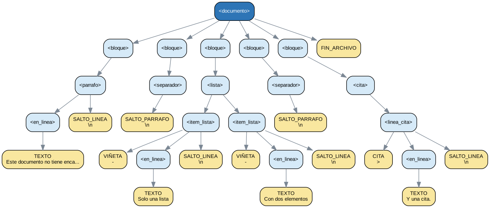

# Casos de Prueba - MarkdownCheck

**Autor:** Edgar Alessandro Chocon Oliva\
**Carnet:** 202212978\
**Curso:** Lenguajes Formales y de Programacion - Seccion B+\
**Universidad de San Carlos de Guatemala - Facultad de Ingenieria**\
**Segundo Semestre 2026**

---

## Resumen

Cada caso corresponde a un archivo de la carpeta `examples/`. Los archivos
generados por cada ejecucion (reportes HTML, `arbol.dot` o reporte de errores)
estan en `salidas/<nombre del caso>/`.

| No. | Caso | Archivo | Tokens | Errores | Resultado |
|---|---|---|---|---|---|
| 1 | Documento valido con todos los elementos | `caso01_documento_completo.md` | 115 | 0 | Correcto |
| 2 | Listas con 4 niveles de anidamiento | `caso02_listas_anidadas.md` | 54 | 0 | Correcto |
| 3 | Citas anidadas en 3 niveles | `caso03_citas_anidadas.md` | 36 | 0 | Correcto |
| 4 | Negrita y cursiva sin cerrar | `caso04_negrita_cursiva_sin_cerrar.md` | 30 | 3 | Correcto |
| 5 | Encabezado invalido | `caso05_encabezado_invalido.md` | 13 | 2 | Correcto |
| 6 | Bloque de codigo sin cerrar | `caso06_bloque_codigo_sin_cerrar.md` | 12 | 1 | Correcto |
| 7 | Indentacion inconsistente | `caso07_indentacion_inconsistente.md` | 33 | 3 | Correcto |
| 8 | Cita mal formada | `caso08_cita_mal_formada.md` | 18 | 2 | Correcto |
| 9 | Codigo en linea sin cerrar | `caso09_codigo_inline_sin_cerrar.md` | 16 | 1 | Correcto |
| 10 | Casos borde validos | `caso10_casos_borde.md` | 54 | 0 | Correcto |
| 11 | Todos los errores en un solo archivo | `caso11_multiples_errores.md` | 34 | 7 | Correcto |
| 12 | Documento sin encabezados | `caso12_sin_encabezados.md` | 14 | 0 | Correcto |
| 13 | Archivo vacio | `caso13_archivo_vacio.md` | 1 | 0 | Correcto |
| 14 | Ejemplo del enunciado (seccion 4.7) | `ejemplo_valido.md` | 74 | 0 | Correcto |
| 15 | Alcance opcional valido | `caso15_alcance_opcional.md` | 82 | 0 | Correcto |
| 16 | Errores en el alcance opcional | `caso16_errores_opcionales.md` | 27 | 3 | Correcto |

Ademas de estos casos, la carpeta `tests/` contiene 124 pruebas unitarias
automatizadas que se ejecutan con:

```bash
python -m unittest discover -s tests -v
```

---

## Caso 1: Documento valido con todos los elementos

**Objetivo:** verificar que un documento con todos los elementos obligatorios
se analiza sin errores y se traduce correctamente a HTML.

**Entrada** (`caso01_documento_completo.md`):

````markdown
# Manual de MarkdownCheck

Este documento usa **todos los elementos obligatorios** del subconjunto, con *cursiva*, `codigo en linea` y combinaciones como **negrita con *cursiva* adentro** y *cursiva con **negrita** adentro*.

## Encabezados

### Nivel tres

#### Nivel cuatro

##### Nivel cinco

###### Nivel seis

## Listas

- Primer nivel con guion
  * Segundo nivel con asterisco
    + Tercer nivel con signo mas
- Otro elemento con **negrita**

## Citas

> Una cita con *cursiva*.
>> Una cita anidada con `codigo`.

## Codigo

```python
def suma(a, b):
    # Los **asteriscos** aqui no se interpretan
    return a + b
```

---

Fin del caso uno.
````

**Resultado esperado:**

- Ningun error.
- Encabezados de los seis niveles (`<h1>` a `<h6>`).
- Combinaciones `<strong>...<em>...</em>...</strong>` y `<em>...<strong>...</strong>...</em>`.
- Lista de 3 niveles usando las tres vinetas (`-`, `*`, `+`).
- Cita de 2 niveles.
- El bloque de codigo conserva `**asteriscos**` y `#` sin interpretarlos.

**Resultado obtenido:**

- 115 tokens, 0 errores. Se generaron los 3 reportes y `arbol.dot`.
- Reporte 2: 9 encabezados (H1: 1, H2: 4, H3 a H6: 1 cada uno), 4 negritas,
  4 cursivas, 2 codigos en linea, profundidad de listas 3, profundidad de citas 2.
- El Reporte 1 contiene `<strong>negrita con <em>cursiva</em> adentro</strong>`
  y `<em>cursiva con <strong>negrita</strong> adentro</em>`.
- El contenido del bloque de codigo aparece literal dentro de
  `<pre><code class="language-python">`.

---

## Caso 2: Listas con 4 niveles de anidamiento

**Objetivo:** verificar INDENT y DEDENT en mas de 3 niveles, el regreso de
varios niveles a la vez y la separacion de dos listas independientes.

**Entrada** (`caso02_listas_anidadas.md`):

```markdown
# Listas anidadas

- Nivel 1: Lenguajes
  - Nivel 2: Formales
    - Nivel 3: Regulares
      - Nivel 4: Automatas finitos
      - Nivel 4: Expresiones regulares
    - Nivel 3: Libres de contexto
  - Nivel 2: De programacion
- Nivel 1: Compiladores con **negrita** y `codigo`

Un parrafo separa dos listas independientes.

* Segunda lista
  + Con sublista
```

**Resultado esperado:** sin errores; dos listas de primer nivel, 10 items,
profundidad maxima 4. Despues de "Expresiones regulares" se emite un DEDENT
y despues de "De programacion" otro, para regresar al nivel 1.

**Resultado obtenido:** 54 tokens, 0 errores. Reporte 2: 2 listas, 10 items
de lista, profundidad de listas 4 niveles. En el arbol de derivacion la rama
mas profunda es `<lista>` -> `<sublista>` -> `<lista>` -> `<sublista>` ->
`<lista>` -> `<sublista>` -> `<lista>`.

---

## Caso 3: Citas anidadas en 3 niveles

**Objetivo:** verificar las dos notaciones de anidamiento (`>>` y `> >`), el
cambio de nivel hacia arriba y hacia abajo y el contenido en linea dentro de
las citas.

**Entrada** (`caso03_citas_anidadas.md`):

```markdown
# Citas anidadas

> Nivel uno de la cita.
>> Nivel dos con la notacion doble.
> > Nivel dos con la notacion separada.
>>> Nivel tres con **negrita** y *cursiva*.
> De regreso al nivel uno.

> Una segunda cita independiente con `codigo`.
```

**Resultado esperado:** sin errores; `>>` y `> >` producen el mismo nivel; la
linea `>>>` abre un tercer `<blockquote>`; la ultima linea `>` regresa al
primer nivel; la linea en blanco separa dos citas independientes.

**Resultado obtenido:** 36 tokens, 0 errores. Reporte 2: 2 citas, 6 lineas de
cita, profundidad de citas 3 niveles. El Reporte 1 anida tres `<blockquote>`
y la linea "De regreso al nivel uno" queda dentro del primero.

---

## Caso 4: Negrita y cursiva sin cerrar

**Objetivo:** verificar NEGRITA_SIN_CERRAR y CURSIVA_SIN_CERRAR en
encabezados, parrafos e items, y que el analisis continua despues de cada error.

**Entrada** (`caso04_negrita_cursiva_sin_cerrar.md`):

```markdown
# Titulo con **negrita sin cerrar

Un parrafo con *cursiva que nunca cierra.

- Un item con **negrita abierta
- Un item correcto con *cursiva*

Este parrafo es **correcto** y el analisis continua.
```

**Resultado esperado:** tres errores lexicos, cada uno en la posicion del
delimitador de apertura; las lineas correctas se analizan normalmente.

**Resultado obtenido:**

| No. | Lexema | Tipo | Fase | Descripcion |
|---|---|---|---|---|
| 1 | `**` | NEGRITA_SIN_CERRAR | Lexico | Negrita sin cerrar iniciada en línea 1, columna 14 |
| 2 | `*` | CURSIVA_SIN_CERRAR | Lexico | Cursiva sin cerrar iniciada en línea 3, columna 16 |
| 3 | `**` | NEGRITA_SIN_CERRAR | Lexico | Negrita sin cerrar iniciada en línea 5, columna 15 |

La cursiva del segundo item y la negrita del ultimo parrafo se reconocen sin
error. Se genero `reporte_errores.html` y no se generaron los reportes 1, 2 y 3.

---

## Caso 5: Encabezado invalido

**Objetivo:** verificar ENCABEZADO_INVALIDO con mas de 6 `#` y la regla de
prioridad de `#` sin espacio.

**Entrada** (`caso05_encabezado_invalido.md`):

```markdown
####### Siete niveles no existen

######## Ocho tampoco

###### Seis niveles si son validos

#sinespacio es texto plano, no un encabezado.
```

**Resultado esperado:** error en las lineas 1 y 3; la linea 5 es un H6
valido; la linea 7 es un parrafo, no un error.

**Resultado obtenido:**

| No. | Lexema | Tipo | Fase | Descripcion |
|---|---|---|---|---|
| 1 | `#######` | ENCABEZADO_INVALIDO | Lexico | Encabezado inválido en línea 1: máximo 6 niveles |
| 2 | `########` | ENCABEZADO_INVALIDO | Lexico | Encabezado inválido en línea 3: máximo 6 niveles |

La linea 5 produce el token NUMERAL `######`. La linea 7 produce un unico
token TEXTO.

---

## Caso 6: Bloque de codigo sin cerrar

**Objetivo:** verificar BLOQUE_CODIGO_SIN_CERRAR y que el contenido del
bloque no se tokeniza aunque contenga simbolos de Markdown.

**Entrada** (`caso06_bloque_codigo_sin_cerrar.md`):

````markdown
# Bloque de codigo sin cerrar

Este parrafo es valido.

```python
def nunca_cierra():
    # Nada de esto se tokeniza: **negrita**, # titulo, - item
    return 0
````

**Resultado esperado:** un error en la linea 5; el contenido hasta el fin del
archivo se emite como un unico TEXTO_LITERAL; el parser no reporta un segundo
error por la misma causa.

**Resultado obtenido:**

| No. | Lexema | Tipo | Fase | Descripcion |
|---|---|---|---|---|
| 1 | ```` ``` ```` | BLOQUE_CODIGO_SIN_CERRAR | Lexico | Bloque de código sin cerrar iniciado en línea 5 |

Despues de CERCA_CODIGO, LENGUAJE (`python`) y SALTO_LINEA se emite un unico
TEXTO_LITERAL con las tres lineas del codigo. No aparecen tokens NEGRITA,
NUMERAL ni VIÑETA dentro del bloque.

---

## Caso 7: Indentacion inconsistente

**Objetivo:** verificar INDENTACION_INVALIDA en sus tres formas: salto de mas
de un nivel, regreso a una sangria que no corresponde a ningun nivel y sangria
impar.

**Entrada** (`caso07_indentacion_inconsistente.md`):

```markdown
# Indentacion inconsistente

- Item correcto
    - Salta de 0 a 4 espacios sin pasar por 2
- Item correcto
  - Sublista correcta
 - Regresa a 1 espacio, que no es ningun nivel

- Lista nueva
   - Tres espacios no son un nivel valido
```

**Resultado esperado:** tres errores sintacticos en la posicion de la vineta
de las lineas 4, 7 y 10; los items se conservan en el arbol.

**Resultado obtenido:**

| No. | Lexema | Tipo | Fase | Descripcion |
|---|---|---|---|---|
| 1 | `-` | INDENTACION_INVALIDA | Sintactico | Indentación inválida en línea 4, columna 5 |
| 2 | `-` | INDENTACION_INVALIDA | Sintactico | Indentación inválida en línea 7, columna 2 |
| 3 | `-` | INDENTACION_INVALIDA | Sintactico | Indentación inválida en línea 10, columna 4 |

Las lineas 3, 5 y 6, correctamente indentadas, no generan error.

---

## Caso 8: Cita mal formada

**Objetivo:** verificar CITA_MAL_FORMADA cuando falta el espacio despues del
ultimo `>`, en una cita simple y en una anidada.

**Entrada** (`caso08_cita_mal_formada.md`):

```markdown
# Citas mal formadas

>Falta el espacio despues del mayor que.
>>Tambien falta en la cita anidada.

> Esta cita esta bien formada.
> > Y esta tambien.
```

**Resultado esperado:** dos errores sintacticos, en la columna del ultimo `>`
de las lineas 3 y 4; las lineas 6 y 7 no generan error.

**Resultado obtenido:**

| No. | Lexema | Tipo | Fase | Descripcion |
|---|---|---|---|---|
| 1 | `>` | CITA_MAL_FORMADA | Sintactico | Cita mal formada en línea 3, columna 1 |
| 2 | `>>` | CITA_MAL_FORMADA | Sintactico | Cita mal formada en línea 4, columna 2 |

---

## Caso 9: Codigo en linea sin cerrar

**Objetivo:** verificar CODIGO_INLINE_SIN_CERRAR y que el resto del documento
se sigue analizando.

**Entrada** (`caso09_codigo_inline_sin_cerrar.md`):

```markdown
# Codigo en linea sin cerrar

Llame a la funcion `analizar() para comenzar.

- Item con `codigo correcto` y texto.
```

**Resultado esperado:** un error en la linea 3, columna 20; el codigo en
linea del item de la linea 5 se reconoce sin error.

**Resultado obtenido:**

| No. | Lexema | Tipo | Fase | Descripcion |
|---|---|---|---|---|
| 1 | `` ` `` | CODIGO_INLINE_SIN_CERRAR | Lexico | Código en línea sin cerrar iniciado en línea 3, columna 20 |

El acento grave sin pareja pasa a formar parte del TEXTO; en la linea 5 se
emiten CODIGO_INLINE, TEXTO_LITERAL y CODIGO_INLINE.

---

## Caso 10: Casos borde validos

**Objetivo:** verificar las reglas de prioridad de la seccion 4.5 en
situaciones ambiguas que no son errores.

**Entrada** (`caso10_casos_borde.md`):

````markdown
# Casos borde validos

***Negrita y cursiva a la vez***

El codigo `**no es negrita**` se toma literal.

#sinespacio no es encabezado y C# tampoco.

--- con texto no es regla horizontal

-----

Una negrita que **empieza en esta linea
y termina en la siguiente** dentro del mismo parrafo.

```
```

- Item con guion
	- Sublista indentada con tabulacion
+ Item con signo mas
* Item con asterisco
````

**Resultado esperado y obtenido:**

| Linea | Situacion | Resultado obtenido |
|---|---|---|
| 3 | `***texto***` | NEGRITA, CURSIVA, TEXTO, CURSIVA, NEGRITA: `<strong><em>...</em></strong>` |
| 5 | Asteriscos dentro de codigo en linea | TEXTO_LITERAL `**no es negrita**`, sin NEGRITA |
| 7 | `#` sin espacio y `#` en medio de la linea | Parrafo con un solo TEXTO |
| 9 | `---` seguido de texto | Parrafo, no REGLA_HORIZONTAL |
| 11 | Cinco guiones solos | REGLA_HORIZONTAL `-----` |
| 13-14 | Negrita que se cierra en la linea siguiente del parrafo | Una sola `<negrita>` que abarca ambas lineas |
| 16-17 | Bloque de codigo vacio | CERCA_CODIGO, SALTO_LINEA, CERCA_CODIGO, sin TEXTO_LITERAL |
| 20 | Sublista indentada con tabulacion | INDENT; la tabulacion cuenta como un nivel |
| 21-22 | Vinetas `+` y `*` | VIÑETA, en el mismo nivel que el primer item |

54 tokens, 0 errores. Reporte 2: 5 parrafos, profundidad de listas 2.

---

## Caso 11: Todos los errores en un solo archivo

**Objetivo:** verificar que el analisis reporta las 7 categorias de error de
la seccion 4.9 en una sola pasada, ordenadas por posicion.

**Entrada** (`caso11_multiples_errores.md`):

````markdown
####### Encabezado invalido

Parrafo con **negrita sin cerrar

Parrafo con *cursiva sin cerrar

Parrafo con `codigo sin cerrar

- Item
    - Indentacion invalida

>Cita mal formada

```
Bloque que nunca se cierra
````

**Resultado esperado:** 7 errores, uno de cada categoria, en orden de linea.

**Resultado obtenido:**

| No. | Lexema | Tipo | Fase | Linea | Columna |
|---|---|---|---|---|---|
| 1 | `#######` | ENCABEZADO_INVALIDO | Lexico | 1 | 1 |
| 2 | `**` | NEGRITA_SIN_CERRAR | Lexico | 3 | 13 |
| 3 | `*` | CURSIVA_SIN_CERRAR | Lexico | 5 | 13 |
| 4 | `` ` `` | CODIGO_INLINE_SIN_CERRAR | Lexico | 7 | 13 |
| 5 | `-` | INDENTACION_INVALIDA | Sintactico | 10 | 5 |
| 6 | `>` | CITA_MAL_FORMADA | Sintactico | 12 | 1 |
| 7 | ```` ``` ```` | BLOQUE_CODIGO_SIN_CERRAR | Lexico | 14 | 1 |

---

## Caso 12: Documento sin encabezados

**Objetivo:** verificar que el Reporte 3 indica explicitamente que no hay
encabezados en lugar de mostrarse vacio.

**Entrada** (`caso12_sin_encabezados.md`):

```markdown
Este documento no tiene encabezados.

- Solo una lista
- Con dos elementos

> Y una cita.
```

**Resultado esperado:** sin errores; el Reporte 3 muestra el mensaje de
documento sin encabezados.

**Resultado obtenido:** 14 tokens, 0 errores. El Reporte 3 muestra: "El
documento no contiene encabezados (# a ######), por lo que no hay entradas
para la tabla de contenido." El Reporte 2 muestra 0 en todos los niveles de
encabezado.

---

## Caso 13: Archivo vacio

**Objetivo:** verificar que un archivo sin contenido no provoca errores ni
fallos.

**Entrada** (`caso13_archivo_vacio.md`): archivo de 0 bytes.

**Resultado esperado:** solo el token FIN_ARCHIVO en la linea 1, columna 1;
arbol con la raiz `<documento>` y la hoja FIN_ARCHIVO; reportes con todos
los conteos en 0.

**Resultado obtenido:** 1 token (FIN_ARCHIVO, linea 1, columna 1), 0 errores.
Los tres reportes se generaron; el Reporte 3 indica que no hay encabezados.

---

## Caso 14: Ejemplo del enunciado

**Objetivo:** comparar los resultados con los que muestra el enunciado en las
secciones 4.7 y 4.8.

**Entrada:** `ejemplo_valido.md`, identico al de la seccion 4.7.

**Resultado esperado** (segun las imagenes del enunciado): 67 palabras,
2 parrafos, 2 encabezados, 8 items de lista, 2 lineas de cita, 1 bloque de
codigo, profundidad de listas 3, profundidad de citas 2, y 1 negrita, 1
cursiva, 1 codigo en linea y 1 regla horizontal.

**Resultado obtenido:** 74 tokens, 0 errores y los mismos valores en el
Reporte 2. El Reporte 1 produce exactamente las etiquetas que describe el
enunciado: `<h1>`, `<ul><li>` anidados en 3 niveles, `<blockquote>` dentro de
`<blockquote>` y `<pre><code class="language-python">`.

---

## Caso 15: Alcance opcional valido

**Objetivo:** verificar los elementos del alcance opcional: lista ordenada con
sublista de tareas, texto tachado, enlaces con formato, imagen con ruta
relativa y resaltado de sintaxis.

**Entrada** (`caso15_alcance_opcional.md`):

````markdown
# Alcance opcional

## Lista ordenada con tareas

1. Disenar la gramatica
  - [x] Definir los tokens
  - [x] Dibujar el AFD
2. Implementar el analizador
  - [ ] Pruebas de integracion
3. Entregar el proyecto

## Texto tachado

La entrega ~~era el viernes~~ es el lunes.

## Enlaces e imagenes

Consulte la [guia de **Markdown**](https://www.markdownguide.org/basic-syntax/) y la [documentacion de Graphviz](https://graphviz.org/doc/info/lang.html).



## Codigo con resaltado de sintaxis

```python
def saludo(nombre):
    # Los **asteriscos** siguen siendo literales
    return f"Hola {nombre}"
```
````

**Resultado esperado:** sin errores; `<ol>` con una sublista `<ul>` de tareas
(dos marcadas y una pendiente), `<del>`, dos `<a>` (uno con `<strong>`
dentro), una `` cuya ruta relativa sigue apuntando al archivo desde la
carpeta del reporte, y el bloque de codigo coloreado por highlight.js.

**Resultado obtenido:** 82 tokens, 0 errores. Reporte 2: 1 lista ordenada,
3 tareas (2 completadas), 1 tachado, 2 enlaces y 1 imagen. En el Reporte 1:

- `<ol>` contiene `<li class="tarea"><input type="checkbox" disabled checked>Definir los tokens</li>`.
- `<a href="https://www.markdownguide.org/basic-syntax/">guia de <strong>Markdown</strong></a>`.
- ``: la ruta
  se ajusto desde `salidas/caso15_alcance_opcional/` y la imagen se muestra.
- El reporte carga highlight.js porque el documento tiene un bloque de codigo.

---

## Caso 16: Errores en el alcance opcional

**Objetivo:** verificar TACHADO_SIN_CERRAR, un error lexico dentro de un item
de tarea, que un enlace incompleto no genera error y que la indentacion de las
listas ordenadas se valida igual que la de las no ordenadas.

**Entrada** (`caso16_errores_opcionales.md`):

```markdown
# Errores en el alcance opcional

Este ~~tachado nunca se cierra.

- [x] Una tarea con **negrita abierta

[Un enlace](sin cierre de parentesis
1. Uno
     2. Indentacion invalida en una lista ordenada
```

**Resultado esperado:** tres errores; la linea 7 (enlace sin parentesis de
cierre) se trata como texto normal, sin error.

**Resultado obtenido:**

| No. | Lexema | Tipo | Fase | Descripcion |
|---|---|---|---|---|
| 1 | `~~` | TACHADO_SIN_CERRAR | Lexico | Tachado sin cerrar iniciado en línea 3, columna 6 |
| 2 | `**` | NEGRITA_SIN_CERRAR | Lexico | Negrita sin cerrar iniciada en línea 5, columna 21 |
| 3 | `2.` | INDENTACION_INVALIDA | Sintactico | Indentación inválida en línea 9, columna 6 |

La casilla `[x]` de la linea 5 se reconoce como CASILLA aunque el resto del
item tenga un error, y la linea 7 produce un unico token TEXTO.
