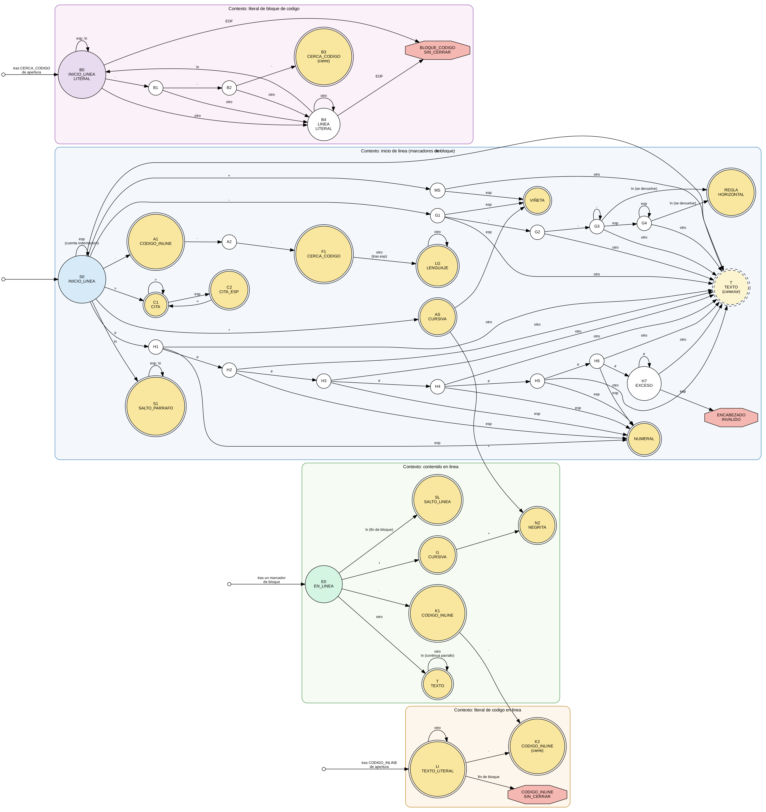

# Manual Tecnico - MarkdownCheck

**Autor:** Edgar Alessandro Chocon Oliva
**Carnet:** 202212978
**Curso:** Lenguajes Formales y de Programacion - Seccion B+
**Universidad de San Carlos de Guatemala - Facultad de Ingenieria**
**Segundo Semestre 2026**

---

## 1. Arquitectura del Sistema

### 1.1 Organizacion en capas

El sistema se organiza en capas. Cada una depende unicamente de las que estan
por debajo, nunca al reves.

```
  interfaz        VentanaPrincipal, EditorCodigo, tema (PyQt6)
      |
      v
  servicios       CargadorArchivos            reportes   GeneradorHTML, estadisticas, indice, DOT
      |                                           |
      v                                           v
  analizador      AnalizadorLexico, AnalizadorSintactico, GestorErrores
      |
      v
  modelos         TipoToken, Token, TipoError, ErrorAnalisis, NodoAST
```

| Capa | Paquete | Responsabilidad |
|---|---|---|
| Presentacion | `src/interfaz/` | Recibir acciones del usuario y mostrar resultados. No contiene logica de analisis |
| Entrada | `src/servicios/` | Validar que el archivo exista, sea un archivo `.md` legible y decodificarlo |
| Salida | `src/reportes/` | Recorrer el arbol de derivacion y producir HTML y DOT |
| Motor de analisis | `src/analizador/` | Tokenizar, construir el arbol y acumular errores |
| Datos | `src/modelos/` | Estructuras sin logica de negocio |

### 1.2 Flujo de datos de un analisis

```
archivo .md
     |
     v  texto : str
AnalizadorLexico.siguiente_token()     AFD manual, un token a la vez
     |                                 errores lexicos -> GestorErrores
     v  Token
AnalizadorSintactico.analizar()        parser descendente recursivo
     |                                 errores sintacticos -> GestorErrores
     v  NodoAST (raiz <documento>)
GeneradorHTML / reportes / DOT         recorren el arbol, nunca el texto original
```

El parser consume los tokens a demanda mediante `siguiente_token()`; el
analizador lexico no necesita producir la lista completa antes de que empiece
el analisis sintactico.

### 1.3 Interfaz grafica

| Clase | Archivo | Responsabilidad |
|---|---|---|
| `VentanaPrincipal` | `interfaz/ventana_principal.py` | Menus, barra de herramientas, apertura y guardado, ejecucion del analisis y presentacion de tokens, errores y arbol |
| `EditorCodigo` | `interfaz/editor_codigo.py` | Editor con numeros de linea, resaltado de la linea actual y de las lineas con error, y navegacion a una posicion |
| `tema` | `interfaz/tema.py` | Paleta clara fija y hoja de estilos QSS; los colores del arbol son los de la seccion 4.10 del enunciado |
| `CargadorArchivos` | `servicios/cargador_archivos.py` | Valida existencia, tipo y extension; intenta UTF-8, cp1252 y latin-1 en ese orden |

`VentanaPrincipal` no contiene logica de analisis: crea el `GestorErrores`,
el `AnalizadorLexico` y el `AnalizadorSintactico`, ejecuta `analizar()` y
muestra lo que devuelven. Cualquier excepcion inesperada se informa en un
cuadro de dialogo para que la aplicacion no se cierre.

---

## 2. Alfabeto y Tokens

### 2.1 Alfabeto

El alfabeto de entrada es el conjunto de caracteres Unicode de un archivo de
texto en UTF-8. Para el AFD los caracteres se agrupan en clases:

| Clase | Caracteres | Uso |
|---|---|---|
| `#` | numeral | Marcador de encabezado |
| `>` | mayor que | Marcador de cita |
| `-` `*` `+` | guion, asterisco, mas | Vinetas; el guion tambien forma la regla horizontal y el asterisco la negrita y la cursiva |
| `` ` `` | acento grave | Codigo en linea y cercas de bloque de codigo |
| `esp` | espacio, tabulacion | Separador e indentacion |
| `\n` | salto de linea | Fin de linea |
| `otro` | cualquier otro caracter | Contenido de texto |

Los finales de linea de Windows (`\r\n`) se normalizan a `\n` al cargar el
archivo, de modo que las posiciones reportadas coinciden con las del editor.

### 2.2 Catalogo de tokens

| Token | Regla | Ejemplo |
|---|---|---|
| NUMERAL | De 1 a 6 `#` al inicio de linea seguidos de un espacio | `## ` |
| VIÑETA | `-`, `*` o `+` al inicio de linea (tras la indentacion) seguido de un espacio | `- ` |
| INDENT / DEDENT | Virtuales. Aumento o disminucion de la indentacion entre items de lista consecutivos | (sin lexema) |
| CITA | Uno o mas `>` al inicio de linea, con o sin un espacio entre ellos | `>>`, `> >` |
| CERCA_CODIGO | Tres acentos graves al inicio de linea | ```` ``` ```` |
| REGLA_HORIZONTAL | Tres o mas `-` solos en la linea | `---` |
| NEGRITA | Doble asterisco fuera de posicion de vineta | `**` |
| CURSIVA | Asterisco simple fuera de posicion de vineta | `*` |
| CODIGO_INLINE | Acento grave simple | `` ` `` |
| TEXTO | Secuencia de caracteres que no inicia ningun otro token | `Lenguajes Formales` |
| SALTO_PARRAFO | Una o mas lineas en blanco consecutivas | (linea vacia) |

Tokens de apoyo agregados a la seccion 4.5 del enunciado:

| Token | Regla | Justificacion |
|---|---|---|
| LENGUAJE | Texto que sigue a la cerca de apertura en la misma linea | Permite generar `<code class="language-python">` sin reinterpretar el texto en el generador |
| TEXTO_LITERAL | Contenido entre cercas de codigo o entre acentos graves | Hace explicito en la tabla de tokens que el contenido no fue tokenizado |
| SALTO_LINEA | Salto de linea que cierra una linea de bloque | Delimita el contenido en linea de encabezados, items y citas; sin el, el parser no sabria donde termina un item |
| FIN_ARCHIVO | Virtual, al agotarse la entrada | Simbolo de fin de cadena de la gramatica aumentada |

### 2.3 Reglas de prioridad

1. **Vineta contra cursiva.** `-`, `*` y `+` solo forman VIÑETA al inicio de
   linea (tras la indentacion) y seguidos de un espacio. En cualquier otra
   posicion, `*` inicia NEGRITA o CURSIVA y `-` y `+` son TEXTO.
2. **Negrita contra cursiva.** Regla de mayor coincidencia (maximal munch):
   `**` siempre se reconoce como NEGRITA antes que como dos CURSIVA. La unica
   excepcion es una secuencia de tres asteriscos que cierra a la vez una
   cursiva y una negrita abiertas (`***texto***`): se cierra primero la que se
   abrio al final, para que el anidamiento quede bien formado.
3. **Encabezado contra texto.** `#` solo forma NUMERAL al inicio de linea y
   seguido de un espacio. `#sinespacio` es TEXTO.
4. **Regla horizontal contra vineta.** `- ` (guion y espacio) es VIÑETA; tres o
   mas guiones sin otro contenido forman REGLA_HORIZONTAL; `--- texto` es TEXTO.
5. **Cerca contra codigo en linea.** Tres acentos graves al inicio de linea
   forman CERCA_CODIGO; uno solo en cualquier posicion forma CODIGO_INLINE.
6. **Modo literal.** Dentro de un bloque de codigo o de un codigo en linea no
   se reconoce ningun otro token hasta el delimitador de cierre.

---

## 3. Automata Finito Determinista

### 3.1 Diagrama



Fuente del diagrama: `docs/imagenes/afd.dot`.

El automata se divide en cuatro contextos. Cada contexto es un sub-automata con
su propio estado inicial; el analizador cambia de contexto despues de emitir
ciertos tokens (seccion 3.3). Esta division corresponde a la estructura de
Markdown: los marcadores de bloque solo tienen significado al inicio de linea,
y el contenido literal no se tokeniza.

Convenciones del diagrama:

- Doble circulo: estado de aceptacion; la etiqueta indica el token reconocido.
- Octagono rojo: estado de error lexico.
- `otro`: cualquier caracter que no aparezca en las demas transiciones del estado.
- `esp`: espacio o tabulacion.
- `T (conector)`: es el mismo estado T del contexto en linea, dibujado otra vez
  para que las transiciones hacia TEXTO no crucen todo el diagrama.

### 3.2 Tabla de estados

**Contexto: inicio de linea**

| Estado | Significado | Transiciones |
|---|---|---|
| S0 | Inicio de linea; cuenta la indentacion | `esp` -> S0, `\n` -> S1, `#` -> H1, `>` -> C1, `` ` `` -> A1, `-` -> G1, `*` -> AS, `+` -> MS, `otro` -> T |
| S1 | Linea en blanco (acepta SALTO_PARRAFO) | `esp`, `\n` -> S1 |
| H1 a H6 | Se han leido de 1 a 6 `#` | `#` -> siguiente H, `esp` -> NUMERAL, `otro` -> T |
| H7 | Se han leido mas de 6 `#` | `#` -> H7, `esp` -> error ENCABEZADO_INVALIDO, `otro` -> T |
| C1 | Se leyo `>` (acepta CITA) | `>` -> C1, `esp` -> C2 |
| C2 | Se leyo `>` y un espacio (acepta CITA) | `>` -> C1 |
| A1 | Se leyo un acento grave (acepta CODIGO_INLINE) | `` ` `` -> A2 |
| A2 | Se leyeron dos acentos graves | `` ` `` -> F1 |
| F1 | Cerca de codigo (acepta CERCA_CODIGO) | `otro` (tras espacios opcionales) -> LG |
| LG | Identificador de lenguaje (acepta LENGUAJE) | `otro` -> LG |
| G1 | Se leyo `-` | `esp` -> VIÑETA, `-` -> G2, `otro` -> T |
| G2 | Se leyeron dos `-` | `-` -> G3, `otro` -> T |
| G3 | Tres o mas `-` | `-` -> G3, `esp` -> G4, `\n` -> REGLA_HORIZONTAL, `otro` -> T |
| G4 | Espacios despues de los guiones | `esp` -> G4, `\n` -> REGLA_HORIZONTAL, `otro` -> T |
| AS | Se leyo `*` al inicio (acepta CURSIVA) | `esp` -> VIÑETA, `*` -> N2 |
| MS | Se leyo `+` | `esp` -> VIÑETA, `otro` -> T |

En G3 y G4 el `\n` solo confirma la regla horizontal; no forma parte de su
lexema y se devuelve a la entrada para emitirse como SALTO_LINEA.

**Contexto: contenido en linea**

| Estado | Significado | Transiciones |
|---|---|---|
| E0 | Inicio de un token en linea | `*` -> I1, `` ` `` -> K1, `\n` -> SL, `otro` -> T |
| T | Texto (acepta TEXTO) | `otro` -> T; `\n` -> T si la linea siguiente continua el parrafo |
| I1 | Un asterisco (acepta CURSIVA) | `*` -> N2 |
| N2 | Dos asteriscos (acepta NEGRITA) | ninguna |
| K1 | Acento grave de apertura (acepta CODIGO_INLINE) | `` ` `` -> K2 (codigo vacio) |
| SL | Fin de linea de bloque (acepta SALTO_LINEA) | ninguna |

**Contexto: literal de codigo en linea**

| Estado | Significado | Transiciones |
|---|---|---|
| LI | Contenido literal (acepta TEXTO_LITERAL) | `otro` -> LI, `` ` `` -> K2, fin de bloque -> error CODIGO_INLINE_SIN_CERRAR |
| K2 | Acento grave de cierre (acepta CODIGO_INLINE) | ninguna |

**Contexto: literal de bloque de codigo**

| Estado | Significado | Transiciones |
|---|---|---|
| B0 | Inicio de una linea dentro del bloque | `esp`, `\n` -> B0, `` ` `` -> B1, `otro` -> B4, EOF -> error BLOQUE_CODIGO_SIN_CERRAR |
| B1, B2 | Uno y dos acentos graves al inicio de la linea | `` ` `` -> siguiente, `otro` -> B4 |
| B3 | Cerca de cierre (acepta CERCA_CODIGO) | ninguna |
| B4 | Linea de contenido literal | `otro` -> B4, `\n` -> B0, EOF -> error BLOQUE_CODIGO_SIN_CERRAR |

Todo lo que se recorre en B0 y B4 antes de la cerca de cierre se emite como un
unico TEXTO_LITERAL, conservando los saltos de linea y la indentacion.

### 3.3 Cambios de contexto

El AFD reconoce un token a la vez, siempre por mayor coincidencia: avanza
mientras exista transicion y, al detenerse, retrocede hasta el ultimo estado de
aceptacion visitado. Despues de emitir el token, el contexto siguiente se
decide asi:

| Token emitido | Contexto siguiente |
|---|---|
| NUMERAL, VIÑETA, CITA | Contenido en linea (los espacios separadores se descartan) |
| CURSIVA o NEGRITA desde AS al inicio de linea | Contenido en linea |
| TEXTO, NEGRITA, CURSIVA, CODIGO_INLINE de cierre | Contenido en linea |
| CODIGO_INLINE de apertura | Literal de codigo en linea |
| TEXTO_LITERAL de codigo en linea | Literal de codigo en linea (espera el cierre) |
| CERCA_CODIGO de apertura | Resto de la linea de la cerca: LENGUAJE opcional y luego SALTO_LINEA |
| SALTO_LINEA despues de la cerca de apertura | Literal de bloque de codigo |
| CERCA_CODIGO de cierre, REGLA_HORIZONTAL | Fin de linea (se emite SALTO_LINEA) |
| SALTO_LINEA, SALTO_PARRAFO | Inicio de linea |
| Error ENCABEZADO_INVALIDO | La linea completa se analiza como contenido en linea (parrafo) |

### 3.4 Generacion de INDENT y DEDENT

La indentacion no la reconoce un estado del AFD, sino una pila de niveles,
igual que en el analizador de Python. Al salir de S0 hacia una VIÑETA se
compara la indentacion contada (cada tabulacion cuenta como 2 espacios) con el
tope de la pila:

1. **Primer item de una lista:** la pila se inicia con la indentacion de ese
   item, que se convierte en la base de la lista. No se emite nada.
2. **Indentacion mayor que el tope:** se apila y se emite un INDENT.
3. **Indentacion menor que el tope:** se desapila y se emite un DEDENT por
   cada nivel hasta que el tope sea menor o igual a la indentacion.
4. **Indentacion igual al tope:** no se emite nada.

Cuando la linea no es un item de lista, cuando aparece una linea en blanco o
al llegar al fin del archivo, se emite un DEDENT por cada nivel abierto y la
pila se vacia.

La pila solo registra la estructura. La validacion de que cada nivel aumente
exactamente 2 espacios la hace el parser (seccion 5.2), porque el enunciado
clasifica INDENTACION_INVALIDA como error sintactico. Por eso el lexico emite
un solo INDENT aunque el salto sea de 0 a 4 espacios.

Para esa validacion, cada token VIÑETA guarda en su atributo `sangria` el
ancho de la indentacion que lo precede. Se usa la sangria y no la columna
porque una tabulacion ocupa una sola columna en la posicion reportada, pero
equivale a 2 espacios de indentacion.

Ejemplo con la lista de `examples/ejemplo_valido.md`:

```
- Analisis lexico                VIÑETA TEXTO SALTO_LINEA
  - Automatas finitos            INDENT VIÑETA TEXTO SALTO_LINEA
  - Expresiones regulares        VIÑETA TEXTO SALTO_LINEA
- Analisis sintactico            DEDENT VIÑETA TEXTO SALTO_LINEA
  - Gramaticas libres...         INDENT VIÑETA TEXTO SALTO_LINEA
    - Recursion por la izq.      INDENT VIÑETA TEXTO SALTO_LINEA
    - Recursion por la der.      VIÑETA TEXTO SALTO_LINEA
- Generacion de codigo           DEDENT DEDENT VIÑETA TEXTO SALTO_LINEA
(linea en blanco)                SALTO_PARRAFO
```

### 3.5 Bloques y delimitadores sin cerrar

Para detectar NEGRITA, CURSIVA o CODIGO_INLINE sin cerrar, el analizador lexico
tokeniza un bloque completo antes de entregar sus tokens. Un bloque es una
linea de encabezado, una linea de item de lista, una linea de cita o un
parrafo completo (que puede ocupar varias lineas).

Mientras tokeniza el bloque mantiene una pila de delimitadores abiertos. Al
terminar el bloque, cada delimitador que siga abierto se reporta como error en
su posicion de apertura y se reclasifica como TEXTO. Asi el parser recibe una
secuencia bien formada y el analisis continua sin errores en cascada.

### 3.6 Parrafos de varias lineas

En un parrafo, el salto de linea entre dos lineas consecutivas forma parte del
TEXTO (es un salto suave y en HTML equivale a un espacio). El parrafo termina
cuando la linea siguiente esta en blanco, inicia otro bloque (`#`, `>`,
cerca, regla horizontal o vineta) o se alcanza el fin del archivo. En ese
punto el salto de linea se emite como SALTO_LINEA. Gracias a esto una negrita
puede abrirse en una linea del parrafo y cerrarse en la siguiente.

---

## 4. Gramatica Libre de Contexto

### 4.1 Definicion formal

G = (N, T, P, S), donde:

- **T (terminales):** NUMERAL, VIÑETA, INDENT, DEDENT, CITA, CERCA_CODIGO,
  LENGUAJE, TEXTO_LITERAL, REGLA_HORIZONTAL, NEGRITA, CURSIVA, CODIGO_INLINE,
  TEXTO, SALTO_LINEA, SALTO_PARRAFO, FIN_ARCHIVO.
- **N (no terminales):** `<documento>`, `<bloque>`, `<separador>`,
  `<encabezado>`, `<parrafo>`, `<lista>`, `<item_lista>`, `<sublista>`,
  `<cita>`, `<linea_cita>`, `<bloque_codigo>`, `<regla_horizontal>`,
  `<en_linea>`, `<negrita>`, `<cursiva>`, `<codigo_inline>`.
- **S (simbolo inicial):** `<documento>`.

### 4.2 Producciones

Se usa notacion EBNF: `{ X }` significa cero o mas repeticiones de X y
`[ X ]` significa que X es opcional.

```
<documento>        ::= { <bloque> } FIN_ARCHIVO

<bloque>           ::= <encabezado>
                     | <parrafo>
                     | <lista>
                     | <cita>(1)
                     | <bloque_codigo>
                     | <regla_horizontal>
                     | <separador>

<separador>        ::= SALTO_PARRAFO

<encabezado>       ::= NUMERAL <en_linea>(∅) SALTO_LINEA

<parrafo>          ::= <en_linea>(∅) SALTO_LINEA

<lista>            ::= <item_lista> { <item_lista> }

<item_lista>       ::= VIÑETA <en_linea>(∅) SALTO_LINEA [ <sublista> ]

<sublista>         ::= INDENT <lista> DEDENT

<cita>(n)          ::= <elemento_cita>(n) { <elemento_cita>(n) }
<elemento_cita>(n) ::= <linea_cita>(n)            si nivel(CITA) = n
                     | <cita>(n+1)                si nivel(CITA) > n
<linea_cita>(n)    ::= CITA <en_linea>(∅) SALTO_LINEA

<bloque_codigo>    ::= CERCA_CODIGO [ LENGUAJE ] SALTO_LINEA
                       [ TEXTO_LITERAL ] CERCA_CODIGO SALTO_LINEA

<regla_horizontal> ::= REGLA_HORIZONTAL SALTO_LINEA

<en_linea>(A)      ::= { <negrita>(A) | <cursiva>(A) | <codigo_inline> | TEXTO }
<negrita>(A)       ::= NEGRITA <en_linea>(A ∪ {NEGRITA}) NEGRITA     si NEGRITA ∉ A
<cursiva>(A)       ::= CURSIVA <en_linea>(A ∪ {CURSIVA}) CURSIVA     si CURSIVA ∉ A
<codigo_inline>    ::= CODIGO_INLINE [ TEXTO_LITERAL ] CODIGO_INLINE
```

`<elemento_cita>` es solo una seleccion entre dos alternativas y no genera un
nodo en el arbol; los hijos de `<cita>` son directamente `<linea_cita>` y
`<cita>` anidadas.

### 4.3 Atributos heredados

Dos no terminales llevan un parametro. Cada parametro toma un numero finito de
valores, por lo que la gramatica sigue siendo libre de contexto: equivale a
escribir una copia del no terminal por cada valor.

- **`n` en `<cita>(n)`: nivel de anidamiento.** El nivel de una CITA es la
  cantidad de `>` de su lexema (`>>` y `> >` valen 2). Una linea de nivel mayor
  abre una `<cita>(n+1)` dentro de la actual (recursion directa); una de nivel
  menor la cierra. Asi `> a`, `>> b`, `> c` produce una cita con `a`, una cita
  anidada con `b` y luego `c`, igual que el HTML esperado.
- **`A` en `<en_linea>(A)`: delimitadores abiertos.** `A` es un subconjunto de
  {NEGRITA, CURSIVA}. Dentro de una negrita no se puede abrir otra negrita, por
  lo que un token NEGRITA dentro de `<en_linea>({NEGRITA})` solo puede ser el
  cierre. Esto elimina la ambiguedad entre abrir y cerrar y deja la gramatica
  LL(1). La recursion mutua negrita-cursiva se mantiene: una negrita puede
  contener una cursiva y viceversa.

### 4.4 Diferencias con la gramatica de referencia y justificacion

| Referencia (seccion 4.6) | Gramatica final | Motivo |
|---|---|---|
| `<documento> ::= <bloque> <documento> \| ε` | `{ <bloque> } FIN_ARCHIVO` | Misma cadena generada. La recursion solo expresa repeticion; FIN_ARCHIVO marca el fin de la cadena (gramatica aumentada) |
| `<parrafo> ::= <en_linea> SALTO_PARRAFO` | `<en_linea> SALTO_LINEA` | Un parrafo puede terminar en el fin del archivo o justo antes de otro bloque, sin linea en blanco. Las lineas en blanco pasan a ser el bloque `<separador>` |
| `<encabezado> ::= NUMERAL <en_linea>` | `... SALTO_LINEA` | El salto de linea delimita donde termina el contenido del encabezado |
| `<lista> ::= <item_lista> <lista> \| <item_lista>` | `<item_lista> { <item_lista> }` | Ambas alternativas comienzan con `<item_lista>`, lo que no es LL(1). La forma con repeticion es la factorizacion por la izquierda |
| `<item_lista> ::= VIÑETA <en_linea> <sublista> \| VIÑETA <en_linea>` | `VIÑETA <en_linea> SALTO_LINEA [ <sublista> ]` | Misma factorizacion por la izquierda |
| `<cita> ::= CITA <bloque> <cita> \| CITA <bloque>` | `<cita>(n)` con niveles | La referencia no relaciona la cantidad de `>` con el anidamiento. Con el nivel, el arbol refleja la jerarquia real de las citas. El contenido de cada linea de cita es `<en_linea>` |
| `<bloque_codigo> ::= CERCA_CODIGO TEXTO_LITERAL CERCA_CODIGO` | Con `[ LENGUAJE ]`, `SALTO_LINEA` y contenido opcional | Lenguaje para la clase CSS; un bloque puede estar vacio |
| `<negrita> ::= "**" <en_linea> "**"` | `<negrita>(A)` | Resuelve el conflicto LL(1) entre abrir y cerrar (seccion 4.3) |
| `<codigo_inline> ::= "`" TEXTO_LITERAL "`"` | `[ TEXTO_LITERAL ]` | Permite el codigo en linea vacio |

### 4.5 Recursion: repeticion e iteracion

Las producciones recursivas de la referencia son de dos tipos:

1. **Recursion que solo expresa repeticion** (`<documento>`, `<lista>` sobre sus
   items, `<en_linea>` sobre sus elementos). Se implementa con un ciclo `while`.
   Esto evita alcanzar el limite de recursion de Python (1000 llamadas) con
   documentos largos y produce un arbol plano, mas legible: un `<documento>`
   con un hijo `<bloque>` por cada bloque.
2. **Recursion que expresa anidamiento** (`<sublista>` contiene una `<lista>`,
   `<cita>(n)` contiene una `<cita>(n+1)`, `<negrita>` contiene `<cursiva>` y
   viceversa). Se implementa con llamadas recursivas reales, de modo que la
   profundidad del arbol es exactamente la profundidad de anidamiento del
   documento.

### 4.6 Conjuntos PRIMERO y verificacion LL(1)

| No terminal | PRIMERO |
|---|---|
| `<encabezado>` | NUMERAL |
| `<parrafo>` | TEXTO, NEGRITA, CURSIVA, CODIGO_INLINE |
| `<lista>`, `<item_lista>` | VIÑETA |
| `<sublista>` | INDENT |
| `<cita>(n)`, `<linea_cita>(n)` | CITA |
| `<bloque_codigo>` | CERCA_CODIGO |
| `<regla_horizontal>` | REGLA_HORIZONTAL |
| `<separador>` | SALTO_PARRAFO |
| `<negrita>(A)` | NEGRITA |
| `<cursiva>(A)` | CURSIVA |
| `<codigo_inline>` | CODIGO_INLINE |

Verificacion de las decisiones del parser:

- **Eleccion de `<bloque>`:** los conjuntos PRIMERO de las siete alternativas
  son disjuntos dos a dos. Un solo token decide la produccion.
- **Repeticion en `<documento>`:** continua mientras el token pertenezca a
  PRIMERO(`<bloque>`) y termina en FIN_ARCHIVO, que no pertenece a ese conjunto.
- **Repeticion en `<lista>`:** continua con VIÑETA. Despues de una lista nunca
  sigue una VIÑETA, porque el analizador lexico solo termina una lista con
  DEDENT, una linea de otro tipo, una linea en blanco o el fin del archivo.
- **`[ <sublista> ]`:** se elige con INDENT, que no pertenece a SIGUIENTE(`<item_lista>`)
  = {VIÑETA, DEDENT} ∪ PRIMERO(`<bloque>`) ∪ {FIN_ARCHIVO}.
- **Repeticion en `<en_linea>(A)`:** continua con TEXTO, CODIGO_INLINE y los
  delimitadores que no estan en A. Se detiene con SALTO_LINEA o con un
  delimitador que esta en A (el cierre de la construccion que lo contiene).
  Ambos conjuntos son disjuntos para cada uno de los cuatro valores de A.
- **`<elemento_cita>(n)`:** se decide con el nivel del token CITA actual
  (igual a n, mayor que n o menor que n, este ultimo termina la repeticion).

### 4.7 Correspondencia con el parser

Cada no terminal se implementa como un metodo de `AnalizadorSintactico` que
devuelve el `NodoAST` de esa produccion:

| No terminal | Metodo |
|---|---|
| `<documento>` | `documento()` |
| `<bloque>` | `bloque()` |
| `<separador>` | `separador()` |
| `<encabezado>` | `encabezado()` |
| `<parrafo>` | `parrafo()` |
| `<lista>` | `lista()` |
| `<item_lista>` | `item_lista()` |
| `<sublista>` | `sublista()` |
| `<cita>(n)` | `cita(nivel)` |
| `<linea_cita>(n)` | `linea_cita()` |
| `<bloque_codigo>` | `bloque_codigo()` |
| `<regla_horizontal>` | `regla_horizontal()` |
| `<en_linea>(A)` | `en_linea(abiertos)` |
| `<negrita>(A)` | `negrita(abiertos)` |
| `<cursiva>(A)` | `cursiva(abiertos)` |
| `<codigo_inline>` | `codigo_inline()` |

---

## 5. Deteccion y Recuperacion de Errores

El analisis nunca se detiene ante un error. Todos los errores se acumulan en
`GestorErrores` y se muestran al final, tanto en la interfaz como en la tabla
de errores. Los tres reportes HTML se generan solo cuando el analisis termina
sin errores, como indica la seccion 4.8 del enunciado.

### 5.1 Errores lexicos

| Error | Deteccion | Recuperacion |
|---|---|---|
| NEGRITA_SIN_CERRAR | El bloque termina con `**` en la pila de delimitadores | Se reporta en la posicion de apertura y el `**` se reclasifica como TEXTO |
| CURSIVA_SIN_CERRAR | El bloque termina con `*` en la pila de delimitadores | Igual que la negrita |
| CODIGO_INLINE_SIN_CERRAR | El bloque termina sin un segundo acento grave | Se reporta en la posicion de apertura; el acento grave se emite como TEXTO y el resto se tokeniza normalmente |
| BLOQUE_CODIGO_SIN_CERRAR | Se llega al fin del archivo en el contexto literal de bloque | Se reporta en la linea de la cerca de apertura; el contenido restante se emite como TEXTO_LITERAL |
| ENCABEZADO_INVALIDO | Mas de 6 `#` seguidos de espacio (estado H7) | Se reporta y la linea se analiza como un parrafo |

### 5.2 Errores sintacticos

| Error | Deteccion | Recuperacion |
|---|---|---|
| INDENTACION_INVALIDA | En `<sublista>`, la sangria de la primera VIÑETA no es la del item padre mas 2; o en `<lista>`, una VIÑETA no tiene la misma sangria que el primer item de esa lista | Se reporta en la posicion de la VIÑETA y el item se acepta en el nivel donde quedo; no se descarta contenido |
| CITA_MAL_FORMADA | En `<linea_cita>`, el token que sigue a CITA comienza en la columna inmediata siguiente al `>` (falta el espacio) | Se reporta y la linea se acepta como cita |
| TOKEN_INESPERADO | Un token que no pertenece a PRIMERO de la produccion esperada | Modo panico: se descartan tokens hasta un token de sincronizacion (SALTO_LINEA, que se consume, SALTO_PARRAFO o FIN_ARCHIVO) y se reanuda en `<documento>` |

Cuando falta la cerca de cierre de un bloque de codigo, el parser acepta
FIN_ARCHIVO en su lugar y no reporta un segundo error, porque el analizador
lexico ya registro BLOQUE_CODIGO_SIN_CERRAR para esa misma causa.

---

## 6. Decisiones de Diseno

| Decision | Justificacion |
|---|---|
| PyQt6 para la interfaz | Libreria de GUI en Python permitida por el enunciado; ofrece tablas con ordenamiento, pestanas y un visor HTML integrado |
| Tabulacion = 2 espacios en la indentacion de listas | Coincide con la regla "2 espacios = 1 nivel", de modo que una tabulacion equivale a un nivel |
| El contenido de una linea de cita es contenido en linea | Mantiene la gramatica LL(1) y cubre el alcance obligatorio: citas anidadas con negrita, cursiva y codigo |
| Una linea sin vineta termina la lista | El subconjunto no incluye las lineas de continuacion de items; asi cada item ocupa exactamente una linea |
| Las lineas en blanco forman el bloque `<separador>` | Aparecen en el arbol de derivacion tal como estan en el documento, y el parrafo puede terminar sin ellas |
| El analizador lexico tokeniza por bloques | Permite reportar los delimitadores sin cerrar en su posicion de apertura y entregar al parser una secuencia bien formada |
