# Manual de Usuario - MarkdownCheck

**Autor:** Edgar Alessandro Chocon Oliva\
**Carnet:** 202212978\
**Curso:** Lenguajes Formales y de Programacion - Seccion B+\
**Universidad de San Carlos de Guatemala - Facultad de Ingenieria**\
**Segundo Semestre 2026**

---

## 1. Introduccion

MarkdownCheck es una aplicacion de escritorio que analiza documentos escritos
en Markdown (archivos `.md`), verifica que esten bien formados y los traduce
a HTML. Para cada documento muestra los tokens reconocidos, los errores
encontrados con su posicion exacta y el arbol de derivacion, y genera tres
reportes HTML que pueden abrirse en cualquier navegador.

---

## 2. Requisitos e Instalacion

| Requisito | Detalle |
|---|---|
| Python | Version 3.10 o superior |
| PyQt6 | Libreria de la interfaz grafica (se instala con `requirements.txt`) |
| Graphviz | Opcional. Solo se usa para ver el arbol de derivacion como imagen |

Pasos de instalacion:

1. Verificar la version de Python:

   ```bash
   python --version
   ```

2. Desde la carpeta `Proyecto2`, instalar las dependencias:

   ```bash
   pip install -r requirements.txt
   ```

3. (Opcional) Instalar Graphviz desde https://graphviz.org/download/ y
   verificar que el comando `dot` este disponible:

   ```bash
   dot -V
   ```

---

## 3. Ejecucion

Desde la carpeta `Proyecto2`:

```bash
python main.py
```

En Windows tambien puede usarse `py main.py`. Para abrir un archivo
directamente al iniciar:

```bash
python main.py examples/ejemplo_valido.md
```

---

## 4. La Ventana Principal

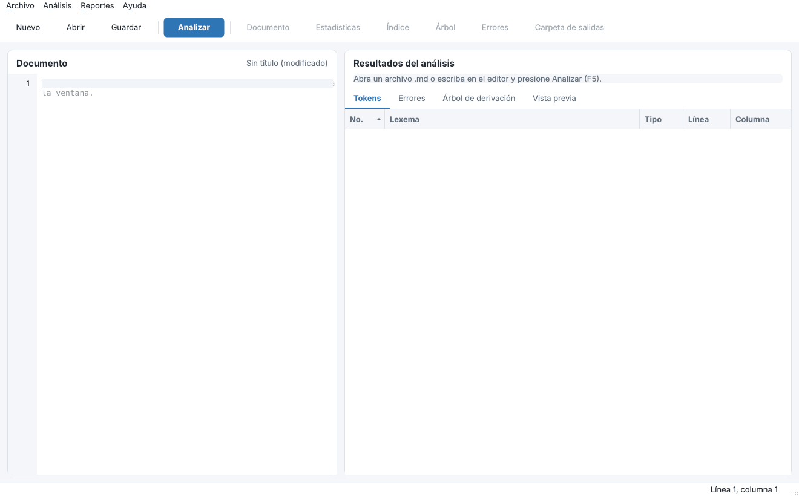

| Zona | Descripcion |
|---|---|
| Barra de menus | Menus Archivo, Analisis, Reportes y Ayuda |
| Barra de herramientas | Botones Nuevo, Abrir, Guardar, **Analizar** y los botones para abrir cada reporte |
| Panel Documento (izquierda) | Editor con numeros de linea. Muestra el nombre del archivo y si tiene cambios sin guardar |
| Panel Resultados (derecha) | Mensaje con el resultado del analisis y las pestanas Tokens, Errores, Arbol de derivacion y Vista previa |
| Barra de estado (abajo) | Mensajes de la aplicacion y la linea y columna del cursor |

---

## 5. Sintaxis Markdown Soportada

La opcion **Ayuda > Sintaxis soportada** (F1) muestra este resumen dentro de
la aplicacion.

| Elemento | Como se escribe | Ejemplo |
|---|---|---|
| Encabezado | De 1 a 6 `#` al inicio de la linea, seguidos de un espacio | `## Titulo` |
| Parrafo | Una o mas lineas de texto separadas de lo demas por una linea en blanco | `Texto normal` |
| Negrita | Texto entre dos asteriscos dobles | `**importante**` |
| Cursiva | Texto entre dos asteriscos simples | `*enfasis*` |
| Codigo en linea | Texto entre acentos graves | `` `variable` `` |
| Lista | `-`, `*` o `+` al inicio de la linea, seguido de un espacio | `- Elemento` |
| Sublista | 2 espacios adicionales por cada nivel | `  - Elemento anidado` |
| Cita | `>` al inicio de la linea, seguido de un espacio | `> Texto citado` |
| Cita anidada | `>>` o `> >` (dos niveles), `>>>` (tres niveles) | `>> Cita dentro de cita` |
| Bloque de codigo | Tres acentos graves en una linea, el codigo y otros tres acentos graves | ```` ```python ```` |
| Regla horizontal | Tres o mas guiones solos en una linea | `---` |

Reglas que conviene recordar:

- Los marcadores `#`, `-`, `*`, `+` y `>` solo tienen significado al inicio de
  la linea. En medio del texto son texto normal.
- `#titulo` (sin espacio) no es un encabezado, es texto.
- Cada nivel de una lista debe estar exactamente 2 espacios a la derecha del
  anterior. Una tabulacion cuenta como un nivel.
- Dentro de un bloque de codigo o de un codigo en linea nada se interpreta:
  `**texto**` se muestra tal cual.
- La negrita y la cursiva deben cerrarse dentro del mismo parrafo, item de
  lista, encabezado o linea de cita.

---

## 6. Cargar un Archivo

Hay tres formas de cargar un documento:

1. **Archivo > Abrir** (Ctrl+O) o el boton **Abrir**: abre un selector de
   archivos que comienza en la carpeta `examples/`.
2. **Arrastrar** un archivo `.md` desde el explorador de archivos y soltarlo
   sobre la ventana.
3. **Escribir** directamente en el editor. Con **Guardar** (Ctrl+S) el texto se
   guarda como archivo `.md`.

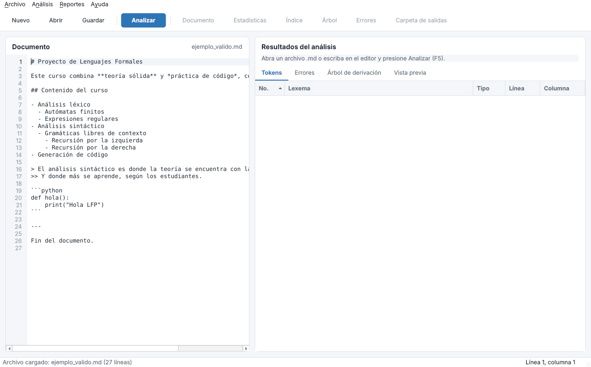

La aplicacion valida que el archivo exista, sea legible y tenga extension
`.md`. Si no se cumple, muestra un mensaje con la causa y no modifica el
editor.

Si el documento tiene cambios sin guardar, la aplicacion pregunta si desea
guardarlos antes de abrir otro archivo o de cerrar.

---

## 7. Analizar el Documento

Presione **Analizar** (F5). El mensaje del panel de resultados indica el
resultado:

| Mensaje | Significado |
|---|---|
| Verde: "Análisis completado sin errores" | El documento es valido. Se generaron los tres reportes y el arbol |
| Rojo: "Se encontraron N errores" | El documento tiene errores. Se abre la pestana Errores y se genera el reporte de errores |
| Gris: "El documento cambió desde el último análisis" | Se edito el texto despues de analizar; presione F5 de nuevo |

En la esquina superior derecha del panel se muestra el tiempo que tomo el
analisis.

---

## 8. Tabla de Tokens

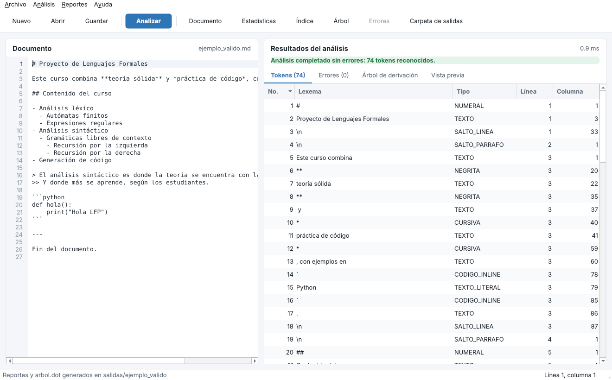

Cada fila es un token reconocido por el analizador lexico, en el orden en que
aparece en el documento.

| Columna | Significado |
|---|---|
| No. | Numero correlativo del token |
| Lexema | Texto exacto del documento. `\n` representa un salto de linea y `(virtual)` un token sin texto |
| Tipo | Clase de token (ver tabla siguiente) |
| Linea, Columna | Posicion donde comienza el token, contando desde 1 |

| Tipo | Que representa |
|---|---|
| NUMERAL | Los `#` de un encabezado |
| VIÑETA | El `-`, `*` o `+` de un item de lista |
| INDENT / DEDENT | Entrada o salida de un nivel de sublista (tokens virtuales, sin texto) |
| CITA | Los `>` de una cita |
| CERCA_CODIGO, LENGUAJE | Los tres acentos graves y el lenguaje del bloque de codigo |
| TEXTO_LITERAL | Contenido de codigo, que no se interpreta |
| NEGRITA, CURSIVA, CODIGO_INLINE | Delimitadores `**`, `*` y acento grave |
| REGLA_HORIZONTAL | La linea `---` |
| TEXTO | Texto normal |
| SALTO_LINEA | Fin de una linea de encabezado, item, cita o parrafo |
| SALTO_PARRAFO | Una o mas lineas en blanco |
| FIN_ARCHIVO | Fin del documento |

Haga clic en el encabezado de una columna para ordenar la tabla. Haga doble
clic en una fila para ubicar el cursor del editor en la posicion del token.

---

## 9. Tabla de Errores

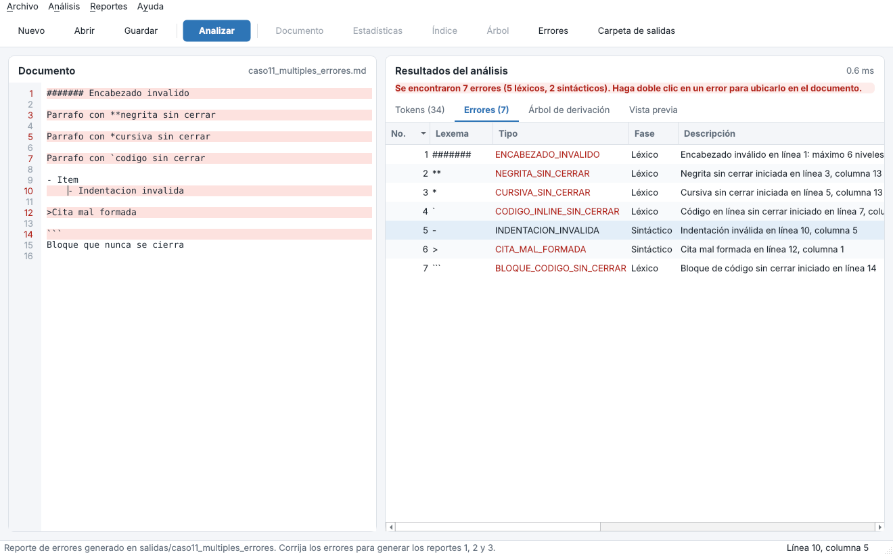

El analisis no se detiene en el primer error: todos los errores del documento
se muestran en una sola pasada, ordenados por posicion. Las lineas con error
se resaltan en rojo en el editor.

| Columna | Significado |
|---|---|
| No. | Numero correlativo del error |
| Lexema | Texto que provoco el error |
| Tipo | Categoria del error (ver tabla siguiente) |
| Fase | Lexico o Sintactico |
| Descripcion | Mensaje con la posicion exacta |
| Linea, Columna | Posicion del error |

Haga doble clic en un error para llevar el cursor a su posicion.

| Tipo de error | Causa | Como corregirlo |
|---|---|---|
| NEGRITA_SIN_CERRAR | Se abrio `**` y no se cerro | Agregue el `**` de cierre en la misma linea o parrafo |
| CURSIVA_SIN_CERRAR | Se abrio `*` y no se cerro | Agregue el `*` de cierre |
| CODIGO_INLINE_SIN_CERRAR | Se abrio un acento grave y no se cerro | Agregue el acento grave de cierre |
| BLOQUE_CODIGO_SIN_CERRAR | Se abrio un bloque con tres acentos graves y el archivo termino | Agregue una linea con tres acentos graves al final del codigo |
| ENCABEZADO_INVALIDO | Mas de 6 `#` al inicio de la linea | Use de 1 a 6 `#` |
| INDENTACION_INVALIDA | Un item de lista no esta 2 espacios a la derecha del anterior, o no coincide con los items de su mismo nivel | Ajuste la sangria a multiplos de 2 espacios |
| CITA_MAL_FORMADA | Falta el espacio despues del ultimo `>` | Escriba `> texto` en lugar de `>texto` |

---

## 10. Arbol de Derivacion y Vista Previa

La pestana **Arbol de derivacion** muestra la estructura que reconocio el
analizador sintactico. Los nodos en azul y negrita son no terminales de la
gramatica (por ejemplo `<lista>`); los nodos en color ocre son los tokens. El
doble clic en un token ubica su posicion en el editor.

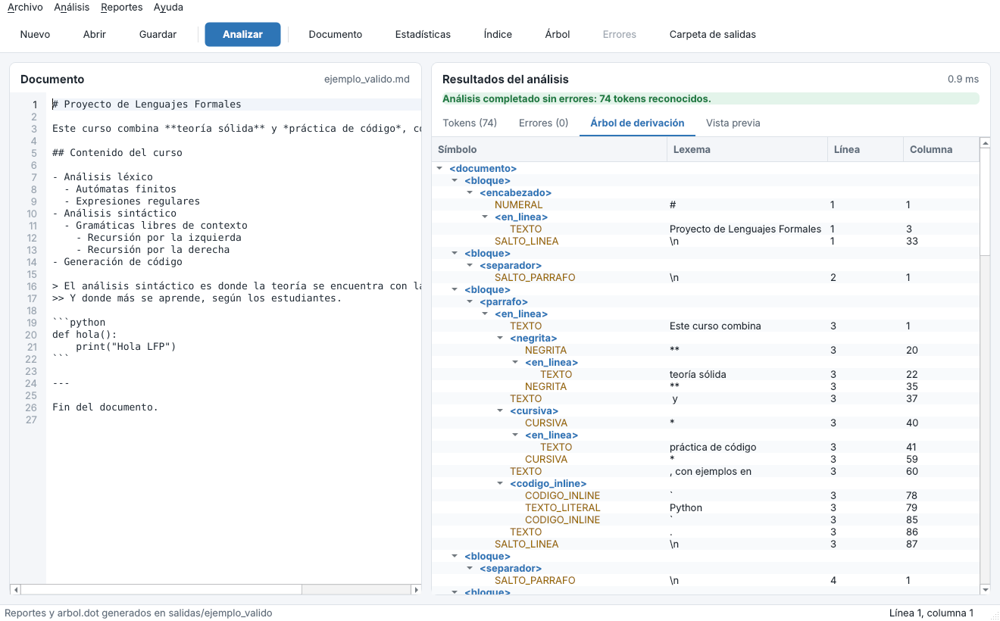

La pestana **Vista previa** muestra el documento traducido a HTML, tal como
aparecera en el Reporte 1.

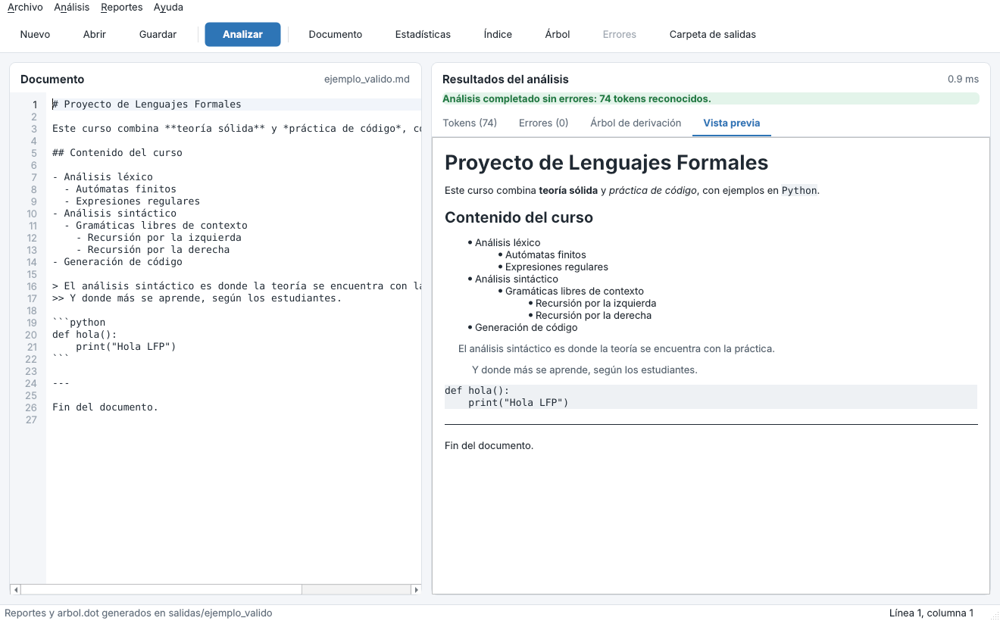

---

## 11. Reportes

### 11.1 Donde se guardan

Cada analisis guarda sus archivos en `salidas/<nombre del archivo>/`. Por
ejemplo, al analizar `ejemplo_valido.md` se crea la carpeta
`salidas/ejemplo_valido/` con:

| Archivo | Contenido |
|---|---|
| `reporte1_documento.html` | Reporte 1: el documento traducido a HTML |
| `reporte2_estadisticas.html` | Reporte 2: estadisticas del documento |
| `reporte3_indice.html` | Reporte 3: tabla de contenido |
| `arbol.dot` | Arbol de derivacion en lenguaje DOT de Graphviz |
| `arbol.svg` | Imagen del arbol (solo si Graphviz esta instalado) |

Los reportes 1, 2 y 3 se generan solo cuando el analisis termina **sin
errores**. Si hay errores, la carpeta contiene unicamente
`reporte_errores.html`.

### 11.2 Como abrirlos

Use los botones de la barra de herramientas o el menu **Reportes**. Cada
reporte se abre en el navegador predeterminado.

| Boton | Atajo | Abre |
|---|---|---|
| Documento | Ctrl+1 | Reporte 1 |
| Estadisticas | Ctrl+2 | Reporte 2 |
| Indice | Ctrl+3 | Reporte 3 |
| Arbol | Ctrl+4 | Imagen del arbol de derivacion |
| Errores | Ctrl+5 | Reporte de errores |
| Carpeta de salidas | Ctrl+6 | La carpeta con todos los archivos generados |

Los botones se habilitan solo cuando el archivo correspondiente existe. En
la parte superior de los tres reportes hay una barra para pasar de uno a otro.

### 11.3 Reporte 1: Documento HTML

Muestra el documento con su formato: encabezados, listas anidadas, citas
anidadas, negrita, cursiva, codigo y reglas horizontales.

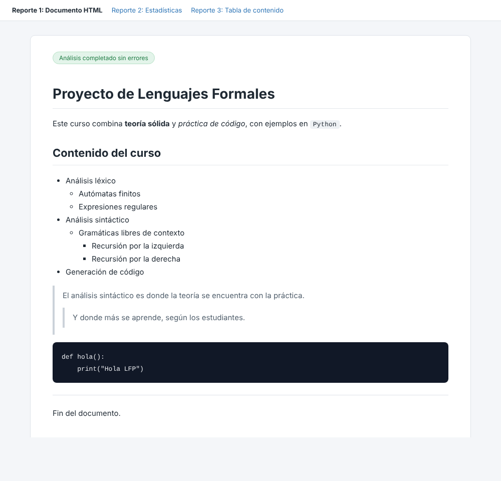

### 11.4 Reporte 2: Estadisticas

Resume la estructura del documento: total de palabras y parrafos, cantidad de
encabezados por nivel en un grafico de barras, cantidad de listas, items,
citas y bloques de codigo, profundidad maxima de anidamiento de listas y citas,
y cantidad de negritas, cursivas, codigos en linea y reglas horizontales. Las
palabras dentro de codigo no se cuentan.

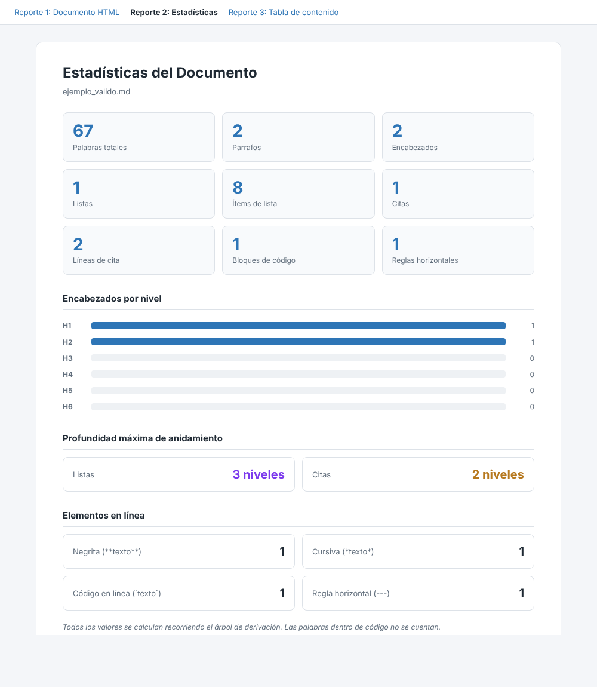

### 11.5 Reporte 3: Tabla de contenido

Lista los encabezados del documento, indentados segun su nivel. Cada entrada
es un enlace: al hacer clic se abre el Reporte 1 en esa seccion.

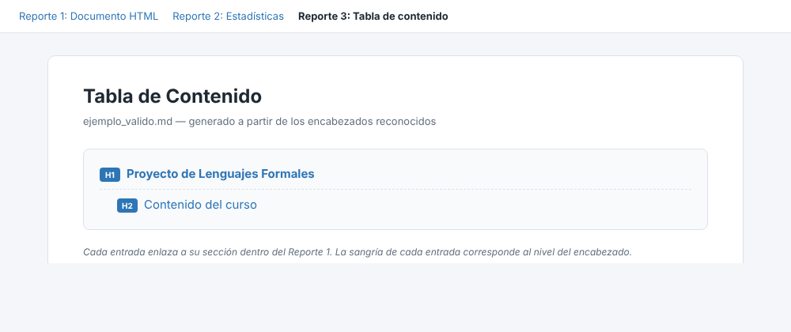

Si el documento no tiene encabezados, el reporte lo indica:

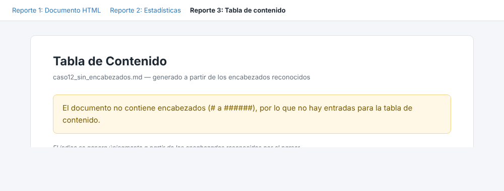

### 11.6 Reporte de errores

Cuando el analisis encuentra errores se genera esta tabla, con la misma
informacion de la pestana Errores.

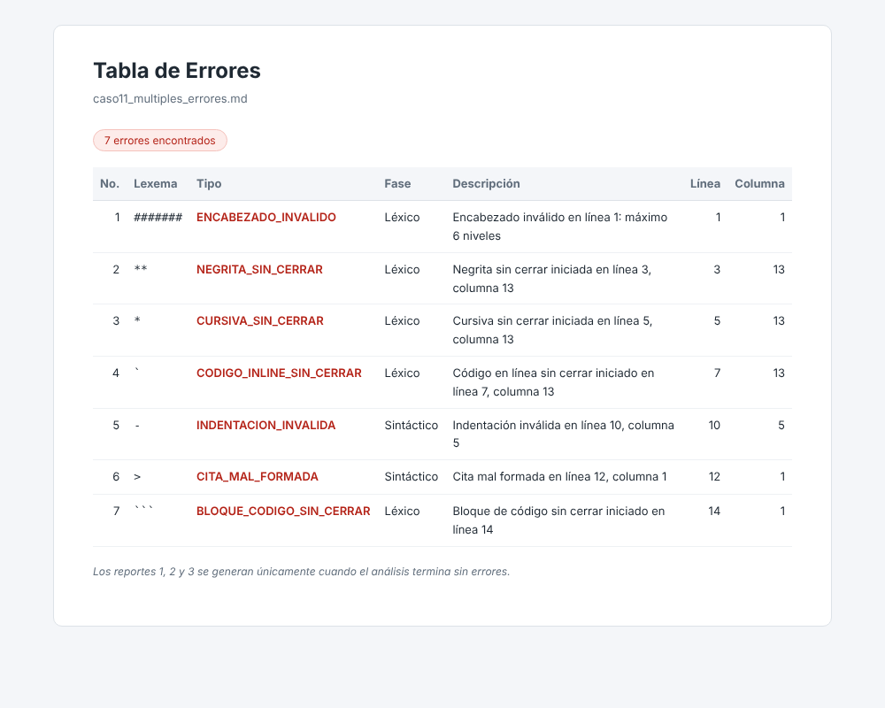

### 11.7 Arbol de derivacion en Graphviz

El boton **Arbol** abre `arbol.svg`. Si Graphviz no esta instalado, la
aplicacion abre la carpeta de salidas, donde esta `arbol.dot`. Ese archivo
puede convertirse en imagen con:

```bash
dot -Tpng arbol.dot -o arbol.png
```

---

## 12. Atajos de Teclado

| Atajo | Accion |
|---|---|
| Ctrl+N | Nuevo documento |
| Ctrl+O | Abrir archivo |
| Ctrl+S | Guardar |
| Ctrl+Shift+S | Guardar como |
| F5 | Analizar |
| Ctrl+1 a Ctrl+6 | Abrir reportes y carpeta de salidas |
| F1 | Sintaxis soportada |
| Ctrl+Q | Salir |

---

## 13. Problemas Frecuentes

| Situacion | Solucion |
|---|---|
| Al ejecutar aparece "PyQt6 no esta instalado" | Ejecute `pip install -r requirements.txt` desde la carpeta `Proyecto2` |
| "Solo se admiten archivos con extension .md" | Cambie la extension del archivo o guardelo con **Guardar como** |
| Los botones Documento, Estadisticas e Indice estan deshabilitados | El ultimo analisis tuvo errores; corrijalos y presione F5 |
| El boton Arbol no muestra una imagen | Instale Graphviz o abra `arbol.dot` desde la carpeta de salidas |
| Los resultados no coinciden con el texto | El documento se edito despues del analisis; presione F5 |
