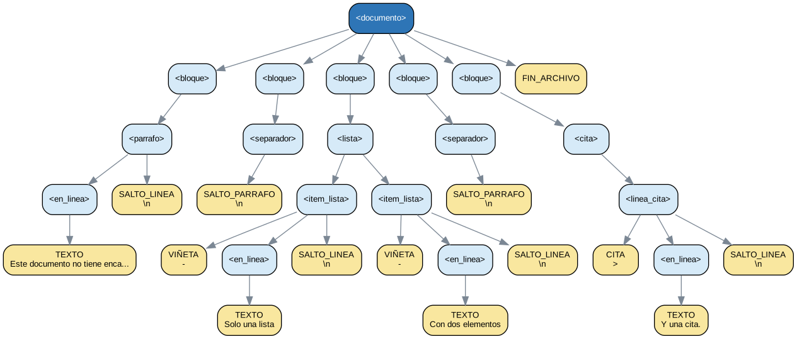

# Alcance opcional

## Lista ordenada con tareas

1. Diseñar la gramática
  - [x] Definir los tokens
  - [x] Dibujar el AFD
2. Implementar el analizador
  - [ ] Pruebas de integración
3. Entregar el proyecto

## Texto tachado

La entrega ~~era el viernes~~ es el lunes.

## Enlaces e imágenes

Consulte la [guía de **Markdown**](https://www.markdownguide.org/basic-syntax/) y la [documentación de Graphviz](https://graphviz.org/doc/info/lang.html).



## Código con resaltado de sintaxis

```python
def saludo(nombre):
    # Los **asteriscos** siguen siendo literales
    return f"Hola {nombre}"
```
