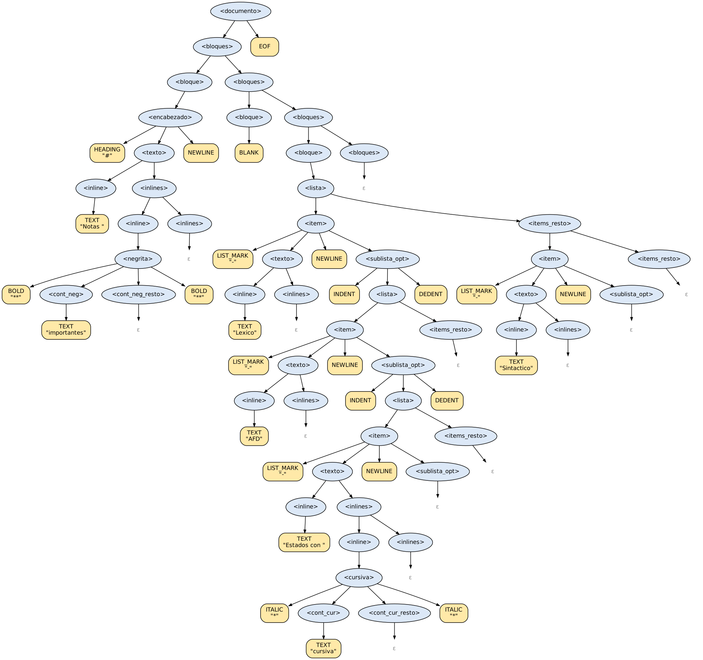
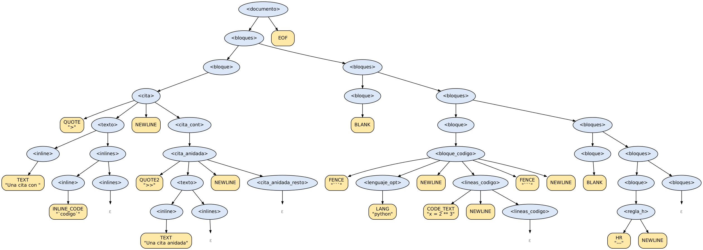

# Tarea #4 — Gramática Libre de Contexto para MarkdownCheck

**Universidad de San Carlos de Guatemala** — Facultad de Ingeniería
Escuela de Ingeniería en Ciencias y Sistemas
Laboratorio de Lenguajes Formales y de Programación — Sección B+
Segundo Semestre 2026

| Estudiante | Carnet |
|---|---|
| Edgar Alessandro Chocon Oliva | 202212978 |

---

## Índice

1. Tabla de terminales
2. Gramática en notación BNF
3. Ajustes para análisis descendente recursivo
4. Conjuntos PRIMERO y SIGUIENTE
5. Árboles de derivación
6. Cadena inválida

---

## 1. Tabla de terminales

El analizador léxico entrega los siguientes tokens al parser. Los marcados como **Agregado** no están en la tabla 4.5 del enunciado o se modificaron respecto a ella.

| Token | Descripción | Ejemplo de lexema | Estado |
|---|---|---|---|
| `HEADING` | 1 a 6 `#` al inicio de línea, seguidos de un espacio. El nivel se guarda en el lexema. | `#`, `###`, `######` | Original |
| `TEXT` | Secuencia de caracteres sin significado especial dentro de una línea. | `Notas `, `Lexico` | Original |
| `BOLD` | Delimitador de negrita. | `**` | Original |
| `ITALIC` | Delimitador de cursiva. | `*` | Original |
| `INLINE_CODE` | Código en línea completo, entre comillas invertidas. | `` `codigo` `` | Original |
| `FENCE` | Apertura o cierre de bloque de código. | ```` ``` ```` | Original |
| `LIST_MARK` | Viñeta de lista no ordenada al inicio de línea (después de la indentación). | `-` | Original |
| `QUOTE` | Marca de cita de primer nivel. | `>` | Modificado |
| `HR` | Regla horizontal: línea que contiene solo `---`. | `---` | Original |
| `NEWLINE` | Fin de una línea con contenido. | `\n` | **Agregado** |
| `BLANK` | Línea vacía (o solo espacios), incluye su salto de línea. | `\n` | **Agregado** |
| `INDENT` | Emitido cuando un ítem de lista tiene más indentación que el anterior. | (2 espacios) | **Agregado** |
| `DEDENT` | Emitido por cada nivel de indentación que se cierra. | (sin lexema) | **Agregado** |
| `QUOTE2` | Marca de cita anidada (segundo nivel). | `>>` | **Agregado** |
| `LANG` | Lenguaje indicado después del `FENCE` de apertura. | `python` | **Agregado** |
| `CODE_TEXT` | Línea cruda dentro de un bloque de código. | `x = 2 ** 3` | **Agregado** |
| `EOF` | Fin de la entrada. | (sin lexema) | **Agregado** |

### Justificación de los tokens agregados

- **`NEWLINE`**: Markdown es un lenguaje orientado a líneas. Sin un token de fin de línea, el parser no puede saber dónde termina un encabezado, un ítem o una línea de cita. El léxico garantiza que toda línea con contenido termina en `NEWLINE` (lo inserta si la última línea del archivo no tiene salto).
- **`BLANK`**: la línea vacía es lo que separa un párrafo de otro. Se distingue de `NEWLINE` para que el parser pueda cerrar párrafos sin mirar más de un token.
- **`INDENT` / `DEDENT`**: el anidamiento de listas depende de la cantidad de espacios. El léxico mantiene una pila de niveles de indentación (igual que Python) y convierte los cambios en tokens, de modo que la gramática siga siendo libre de contexto y permita anidamiento ilimitado (cubre los 3 niveles obligatorios y más).
- **`QUOTE2`**: separar `>>` de `>` permite que el parser distinga una cita anidada con un solo token. El léxico aplica la regla de la coincidencia más larga.
- **`LANG`** y **`CODE_TEXT`**: al leer un `FENCE` de apertura el léxico entra en *modo código*; todo lo que encuentra hasta el siguiente `FENCE` se entrega como `CODE_TEXT`. Así `x = 2 ** 3` no produce un `BOLD` falso.
- **`EOF`**: marca explícita para verificar que se consumió toda la entrada.

### Reglas léxicas de desambiguación

| Situación | Regla |
|---|---|
| `**` contra `*` | Coincidencia más larga: `**` es `BOLD`. |
| `>>` contra `>` | Coincidencia más larga: `>>` es `QUOTE2`. |
| `---` contra `-` | Una línea que contiene solo `---` es `HR`; `-` seguido de espacio es `LIST_MARK`. |
| `**` dentro de un bloque de código | En modo código no se reconocen tokens de formato; se emite `CODE_TEXT`. |
| `#` sin espacio después (`#hola`) | No es encabezado; se trata como `TEXT`. |

---

## 2. Gramática en notación BNF

**Símbolo inicial:** `<documento>`
Notación: `<nombre>` para no terminales, MAYÚSCULAS para tokens, `ε` para la cadena vacía.

```bnf
<documento>          ::= <bloques> EOF

<bloques>            ::= <bloque> <bloques>
                       | ε

<bloque>             ::= <encabezado>
                       | <parrafo>
                       | <lista>
                       | <cita>
                       | <bloque_codigo>
                       | <regla_h>
                       | BLANK

<!-- Encabezados (# a ######) -->
<encabezado>         ::= HEADING <texto> NEWLINE

<!-- Párrafos de una o más líneas -->
<parrafo>            ::= <linea> <parrafo_resto>
<parrafo_resto>      ::= <linea> <parrafo_resto>
                       | ε
<linea>              ::= <texto> NEWLINE

<!-- Contenido en línea -->
<texto>              ::= <inline> <inlines>
<inlines>            ::= <inline> <inlines>
                       | ε
<inline>             ::= TEXT
                       | INLINE_CODE
                       | <negrita>
                       | <cursiva>

<negrita>            ::= BOLD <cont_neg> <cont_neg_resto> BOLD
<cont_neg>           ::= TEXT
                       | INLINE_CODE
                       | <cursiva>
<cont_neg_resto>     ::= <cont_neg> <cont_neg_resto>
                       | ε

<cursiva>            ::= ITALIC <cont_cur> <cont_cur_resto> ITALIC
<cont_cur>           ::= TEXT
                       | INLINE_CODE
<cont_cur_resto>     ::= <cont_cur> <cont_cur_resto>
                       | ε

<!-- Listas no ordenadas con anidamiento ilimitado -->
<lista>              ::= <item> <items_resto>
<items_resto>        ::= <item> <items_resto>
                       | ε
<item>               ::= LIST_MARK <texto> NEWLINE <sublista_opt>
<sublista_opt>       ::= INDENT <lista> DEDENT
                       | ε

<!-- Citas y citas anidadas -->
<cita>               ::= QUOTE <texto> NEWLINE <cita_cont>
<cita_cont>          ::= QUOTE <texto> NEWLINE <cita_cont>
                       | <cita_anidada>
                       | ε
<cita_anidada>       ::= QUOTE2 <texto> NEWLINE <cita_anidada_resto>
<cita_anidada_resto> ::= QUOTE2 <texto> NEWLINE <cita_anidada_resto>
                       | ε

<!-- Bloques de código -->
<bloque_codigo>      ::= FENCE <lenguaje_opt> NEWLINE <lineas_codigo> FENCE NEWLINE
<lenguaje_opt>       ::= LANG
                       | ε
<lineas_codigo>      ::= CODE_TEXT NEWLINE <lineas_codigo>
                       | ε

<!-- Regla horizontal -->
<regla_h>            ::= HR NEWLINE
```

> Nota: las líneas `<!-- ... -->` son solo comentarios para ordenar la lectura; no forman parte de la gramática.

### Cobertura del alcance obligatorio

| Elemento | Producción |
|---|---|
| Encabezados `#` a `######` | `<encabezado>` (el nivel viaja en el lexema de `HEADING`) |
| Párrafos de una o más líneas | `<parrafo>`, `<parrafo_resto>` |
| Negrita | `<negrita>` |
| Cursiva | `<cursiva>` (también dentro de negrita) |
| Código en línea | `INLINE_CODE` en `<inline>`, `<cont_neg>`, `<cont_cur>` |
| Bloques de código | `<bloque_codigo>` con lenguaje opcional |
| Listas con 3+ niveles | `<item>` → `<sublista_opt>` → `INDENT <lista> DEDENT` (recursivo, sin límite) |
| Citas `>` y `>>` | `<cita>`, `<cita_anidada>` |
| Regla horizontal | `<regla_h>` |

---

## 3. Ajustes para análisis descendente recursivo

Un parser descendente recursivo debe decidir qué producción usar viendo **un solo token**. Para eso la gramática no puede tener recursión por la izquierda (el procedimiento se llamaría a sí mismo sin consumir nada, ciclo infinito) y las alternativas que comparten prefijo deben factorizarse. Estos son los cambios aplicados al tomar como punto de partida la gramática de referencia 4.6:

| # | Forma de partida (directa) | Problema | Forma ajustada |
|---|---|---|---|
| 1 | `<bloques> ::= <bloques> <bloque> \| <bloque>` | Recursión por la izquierda: `parseBloques()` se llama a sí mismo antes de consumir un token. | `<bloques> ::= <bloque> <bloques> \| ε` |
| 2 | `<texto> ::= <texto> <inline> \| <inline>` | Recursión por la izquierda. | `<texto> ::= <inline> <inlines>`, `<inlines> ::= <inline> <inlines> \| ε` |
| 3 | `<parrafo> ::= <parrafo> <linea> \| <linea>` | Recursión por la izquierda. | `<parrafo> ::= <linea> <parrafo_resto>` |
| 4 | `<lista> ::= <item> \| <item> <lista>` | Dos alternativas empiezan con `<item>` (mismo PRIMERO = `LIST_MARK`). | Factorizado: `<lista> ::= <item> <items_resto>` |
| 5 | `<item> ::= LIST_MARK <texto> NEWLINE \| LIST_MARK <texto> NEWLINE <lista_anidada>` | Prefijo común `LIST_MARK <texto> NEWLINE`. Además, reglas separadas por nivel (`-`, `  -`, `    -`) limitan el anidamiento y dependen de contar espacios. | Factorizado con `<sublista_opt> ::= INDENT <lista> DEDENT \| ε`; la indentación la resuelve el léxico con `INDENT`/`DEDENT`, lo que da anidamiento ilimitado. |
| 6 | `<cita> ::= '>' <texto> \| '>' <cita>` (anidamiento con `>` repetidos) | Prefijo común `>` y ambigüedad entre `> >` y `>>`. | Token propio `QUOTE2` y factorización con `<cita_cont>` y `<cita_anidada>`. |
| 7 | `<bloque_codigo> ::= FENCE LANG NEWLINE ... \| FENCE NEWLINE ...` | Prefijo común `FENCE`. | Factorizado con `<lenguaje_opt> ::= LANG \| ε`. |
| 8 | `<negrita> ::= BOLD <texto> BOLD` | `<texto>` puede contener otra `<negrita>`, así que al ver `BOLD` dentro no se sabe si abre o cierra (conflicto PRIMERO/SIGUIENTE). | Contenido restringido: `<cont_neg>` admite `TEXT`, `INLINE_CODE` o `<cursiva>`, pero no otra negrita. Igual para `<cursiva>` con `<cont_cur>`. |
| 9 | Fin de línea implícito | Sin token de fin de línea no se sabe dónde termina un encabezado o un ítem. | Se agregan `NEWLINE` y `BLANK` en todas las producciones de línea. |

Con estos ajustes, cada no terminal se implementa como una función que hace un `switch` sobre el token actual.

---

## 4. Conjuntos PRIMERO y SIGUIENTE

Para abreviar se define:

- **I** = { `TEXT`, `INLINE_CODE`, `BOLD`, `ITALIC` } (inicio de contenido en línea)
- **B** = I ∪ { `HEADING`, `LIST_MARK`, `QUOTE`, `FENCE`, `HR`, `BLANK`, `EOF` } (lo que puede venir después de un bloque)

| No terminal | PRIMERO | SIGUIENTE |
|---|---|---|
| `<documento>` | I ∪ { HEADING, LIST_MARK, QUOTE, FENCE, HR, BLANK, EOF } | { $ } |
| `<bloques>` | I ∪ { HEADING, LIST_MARK, QUOTE, FENCE, HR, BLANK, ε } | { EOF } |
| `<bloque>` | I ∪ { HEADING, LIST_MARK, QUOTE, FENCE, HR, BLANK } | B |
| `<encabezado>` | { HEADING } | B |
| `<parrafo>` | I | B |
| `<parrafo_resto>` | I ∪ { ε } | B |
| `<linea>` | I | B |
| `<texto>` | I | { NEWLINE } |
| `<inlines>` | I ∪ { ε } | { NEWLINE } |
| `<inline>` | I | I ∪ { NEWLINE } |
| `<negrita>` | { BOLD } | I ∪ { NEWLINE } |
| `<cont_neg>` | { TEXT, INLINE_CODE, ITALIC } | { TEXT, INLINE_CODE, ITALIC, BOLD } |
| `<cont_neg_resto>` | { TEXT, INLINE_CODE, ITALIC, ε } | { BOLD } |
| `<cursiva>` | { ITALIC } | I ∪ { NEWLINE } |
| `<cont_cur>` | { TEXT, INLINE_CODE } | { TEXT, INLINE_CODE, ITALIC } |
| `<cont_cur_resto>` | { TEXT, INLINE_CODE, ε } | { ITALIC } |
| `<lista>` | { LIST_MARK } | B ∪ { DEDENT } |
| `<items_resto>` | { LIST_MARK, ε } | B ∪ { DEDENT } |
| `<item>` | { LIST_MARK } | B ∪ { DEDENT } |
| `<sublista_opt>` | { INDENT, ε } | B ∪ { DEDENT } |
| `<cita>` | { QUOTE } | B |
| `<cita_cont>` | { QUOTE, QUOTE2, ε } | B |
| `<cita_anidada>` | { QUOTE2 } | B |
| `<cita_anidada_resto>` | { QUOTE2, ε } | B |
| `<bloque_codigo>` | { FENCE } | B |
| `<lenguaje_opt>` | { LANG, ε } | { NEWLINE } |
| `<lineas_codigo>` | { CODE_TEXT, ε } | { FENCE } |
| `<regla_h>` | { HR } | B |

### Verificación LL(1)

1. **Alternativas no anulables:** en `<bloque>`, `<inline>`, `<cont_neg>`, `<cont_cur>` y `<cita_cont>` los conjuntos PRIMERO de cada alternativa son disjuntos. ✔
2. **Producciones con ε:** se revisa PRIMERO(alternativa) ∩ SIGUIENTE(no terminal):

| No terminal | PRIMERO sin ε | SIGUIENTE | Intersección |
|---|---|---|---|
| `<bloques>` | I ∪ {HEADING, …, BLANK} | { EOF } | ∅ ✔ |
| `<inlines>` | I | { NEWLINE } | ∅ ✔ |
| `<cont_neg_resto>` | { TEXT, INLINE_CODE, ITALIC } | { BOLD } | ∅ ✔ |
| `<cont_cur_resto>` | { TEXT, INLINE_CODE } | { ITALIC } | ∅ ✔ |
| `<sublista_opt>` | { INDENT } | B ∪ { DEDENT } | ∅ ✔ |
| `<cita_anidada_resto>` | { QUOTE2 } | B | ∅ ✔ |
| `<lenguaje_opt>` | { LANG } | { NEWLINE } | ∅ ✔ |
| `<lineas_codigo>` | { CODE_TEXT } | { FENCE } | ∅ ✔ |
| **`<parrafo_resto>`** | I | B | **I — conflicto C1** |
| **`<items_resto>`** | { LIST_MARK } | B ∪ { DEDENT } | **{ LIST_MARK } — conflicto C2** |
| **`<cita_cont>`** | { QUOTE, QUOTE2 } | B | **{ QUOTE } — conflicto C3** |

### Conflictos encontrados y su resolución

**C1 — `<parrafo_resto>` con tokens de I.** Si después de una línea de texto viene otra línea de texto, la gramática permite dos lecturas: la segunda línea continúa el mismo párrafo, o termina el párrafo y empieza uno nuevo (`<bloques>` → `<bloque>` → `<parrafo>`).
**Resolución (regla codiciosa):** el parser siempre elige continuar el párrafo (`<linea> <parrafo_resto>`) mientras el token sea de I. Esto coincide con la semántica de Markdown: líneas consecutivas forman un solo párrafo y solo una línea vacía (`BLANK`) lo cierra. Como `BLANK` no está en I, en ese punto se elige ε sin ambigüedad.

**C2 — `<items_resto>` con `LIST_MARK`.** Un `LIST_MARK` puede ser otro ítem de la lista actual o el inicio de una lista nueva.
**Resolución (codiciosa):** se toma como otro ítem de la misma lista. Dos listas solo se separan con una línea en blanco o con otro bloque. Al terminar una sublista, el léxico emite `DEDENT` antes del siguiente `LIST_MARK`, así que los ítems siempre se asignan al nivel correcto.

**C3 — `<cita_cont>` con `QUOTE`.** Una línea `>` puede seguir la cita actual o abrir otra cita.
**Resolución (codiciosa):** se continúa la cita actual; líneas `>` consecutivas forman una sola cita.

Las tres reglas son la misma idea que el *else colgante* en los lenguajes de programación: ante la duda, el parser se queda con la construcción más larga. En código basta con escribir el `while`/`if` de la regla de continuación antes de retornar:

```text
parseParrafoResto():
    while token ∈ { TEXT, INLINE_CODE, BOLD, ITALIC }:
        parseLinea()
    // si no, ε
```

---

## 5. Árboles de derivación

Los árboles se generaron con Graphviz (`arbol_cadena1.dot`, `arbol_cadena2.dot`). Óvalos azules = no terminales, cajas amarillas = tokens.

### Cadena 1

```markdown
# Notas **importantes**

- Lexico
  - AFD
    - Estados con *cursiva*
- Sintactico
```

**Secuencia de tokens:**

| # | Token | Lexema |
|---|---|---|
| 1 | HEADING | `#` |
| 2 | TEXT | `Notas ` |
| 3 | BOLD | `**` |
| 4 | TEXT | `importantes` |
| 5 | BOLD | `**` |
| 6 | NEWLINE | `\n` |
| 7 | BLANK | `\n` |
| 8 | LIST_MARK | `-` |
| 9 | TEXT | `Lexico` |
| 10 | NEWLINE | `\n` |
| 11 | INDENT | |
| 12 | LIST_MARK | `-` |
| 13 | TEXT | `AFD` |
| 14 | NEWLINE | `\n` |
| 15 | INDENT | |
| 16 | LIST_MARK | `-` |
| 17 | TEXT | `Estados con ` |
| 18 | ITALIC | `*` |
| 19 | TEXT | `cursiva` |
| 20 | ITALIC | `*` |
| 21 | NEWLINE | `\n` |
| 22 | DEDENT | |
| 23 | DEDENT | |
| 24 | LIST_MARK | `-` |
| 25 | TEXT | `Sintactico` |
| 26 | NEWLINE | `\n` |
| 27 | EOF | |

En forma compacta:
`HEADING TEXT BOLD TEXT BOLD NEWLINE BLANK LIST_MARK TEXT NEWLINE INDENT LIST_MARK TEXT NEWLINE INDENT LIST_MARK TEXT ITALIC TEXT ITALIC NEWLINE DEDENT DEDENT LIST_MARK TEXT NEWLINE EOF`

**Árbol de derivación:**



Puntos clave: la lista tiene 3 niveles mediante `<sublista_opt>` → `INDENT <lista> DEDENT` aplicado dos veces; los dos `DEDENT` consecutivos cierran los niveles 3 y 2 antes de que `- Sintactico` se agregue como segundo ítem del nivel 1 (en `<items_resto>`).

### Cadena 2

````markdown
> Una cita con `codigo`
>> Una cita anidada

```python
x = 2 ** 3
```

---
````

**Secuencia de tokens:**

| # | Token | Lexema |
|---|---|---|
| 1 | QUOTE | `>` |
| 2 | TEXT | `Una cita con ` |
| 3 | INLINE_CODE | `` `codigo` `` |
| 4 | NEWLINE | `\n` |
| 5 | QUOTE2 | `>>` |
| 6 | TEXT | `Una cita anidada` |
| 7 | NEWLINE | `\n` |
| 8 | BLANK | `\n` |
| 9 | FENCE | ```` ``` ```` |
| 10 | LANG | `python` |
| 11 | NEWLINE | `\n` |
| 12 | CODE_TEXT | `x = 2 ** 3` |
| 13 | NEWLINE | `\n` |
| 14 | FENCE | ```` ``` ```` |
| 15 | NEWLINE | `\n` |
| 16 | BLANK | `\n` |
| 17 | HR | `---` |
| 18 | NEWLINE | `\n` |
| 19 | EOF | |

En forma compacta:
`QUOTE TEXT INLINE_CODE NEWLINE QUOTE2 TEXT NEWLINE BLANK FENCE LANG NEWLINE CODE_TEXT NEWLINE FENCE NEWLINE BLANK HR NEWLINE EOF`

**Árbol de derivación:**



Puntos clave: el `**` de `x = 2 ** 3` no genera `BOLD` porque el léxico está en modo código y entrega toda la línea como `CODE_TEXT`; `>>` se reconoce como `QUOTE2` por coincidencia más larga y se deriva en `<cita_cont>` → `<cita_anidada>`.

---

## 6. Cadena inválida

```markdown
Texto **sin cerrar
```

**Secuencia de tokens:**
`TEXT("Texto ") BOLD("**") TEXT("sin cerrar") NEWLINE EOF`

**Derivación hasta el error:**

```text
<documento>
⇒ <bloques> EOF
⇒ <bloque> <bloques> EOF                       (token TEXT ∈ PRIMERO(<bloque>))
⇒ <parrafo> <bloques> EOF
⇒ <linea> <parrafo_resto> <bloques> EOF
⇒ <texto> NEWLINE ...
⇒ <inline> <inlines> NEWLINE ...
⇒ TEXT <inlines> NEWLINE ...                   consume TEXT("Texto ")
⇒ TEXT <inline> <inlines> NEWLINE ...          (BOLD ∈ PRIMERO(<inline>))
⇒ TEXT <negrita> <inlines> NEWLINE ...
⇒ TEXT BOLD <cont_neg> <cont_neg_resto> BOLD ...  consume BOLD
⇒ TEXT BOLD TEXT <cont_neg_resto> BOLD ...      consume TEXT("sin cerrar")
⇒ TEXT BOLD TEXT ε BOLD ...                     token actual = NEWLINE
✗ ERROR: se esperaba BOLD, se encontró NEWLINE
```

**Por qué falla:** en `<cont_neg_resto>` el token actual es `NEWLINE`. No pertenece a PRIMERO(`<cont_neg>`) = { TEXT, INLINE_CODE, ITALIC } ni a SIGUIENTE(`<cont_neg_resto>`) = { BOLD }. El parser toma ε y al intentar emparejar el `BOLD` de cierre de `<negrita>` encuentra `NEWLINE`. La negrita quedó sin cerrar antes del fin de línea, así que la gramática rechaza la cadena.

**Mensaje sugerido (tabla de errores 4.9):** `Error sintáctico, línea 1, columna 19: se esperaba "**" para cerrar negrita, se encontró fin de línea.`

**Otro ejemplo rechazado:** una cita anidada sin cita padre (`>> hola` como primera línea). Su primer token es `QUOTE2`, que no pertenece a PRIMERO(`<bloque>`), así que el error ocurre en el primer paso de `<bloques>`.
